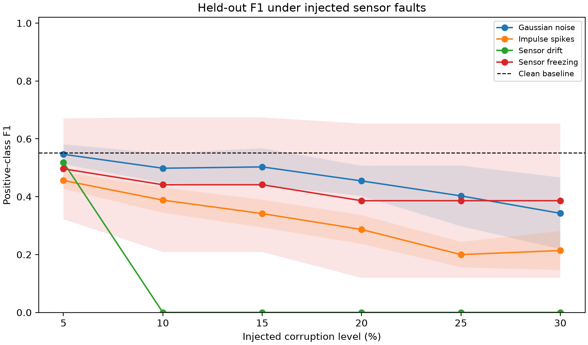
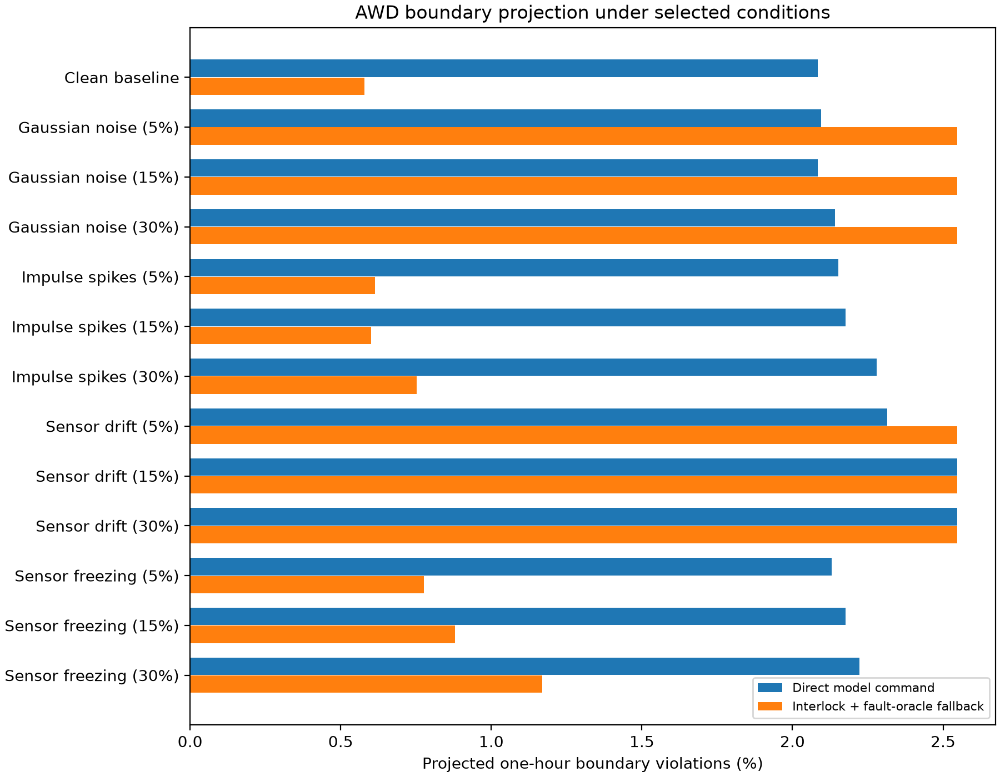

# CHAPTER 3

# RESULTS AND DISCUSSIONS

This chapter reports the results of a chronological holdout evaluation of the Random Forest classifier and controlled sensor-fault experiments using the project's synthetic rice-paddy dataset. The analysis addresses baseline classification (SOP 2), degradation under sensor corruption (SOP 3), projected AWD-boundary violations (SOP 4), software gate-control and fallback behavior relevant to the proposed embedded validation (SOP 5), and provisional quality-assurance recommendations (SOP 6).

The results are computational simulations. The dataset and target labels are synthetic, actuator response rates are assumed for the one-hour projection, and the fault-injection mask used in part of the fallback analysis is an oracle. The experiments do not establish field performance, physical irrigation safety, or schistosomiasis mitigation effectiveness.

## 3.1 Dataset Profile and Baseline Performance (SOP 1 and SOP 2)

### 3.1.1 Dataset characteristics

The active dataset contains 4,320 hourly records representing a generated 180-day period. It contains 12 predictor variables, the `Snail_Habitat_Risk` label, and the `AWD_Gate_Action` target. There are no missing values. The values are generated from configured temporal, crop-stage, hydrological, soil, and vegetation rules; they are not field measurements.

**Table 3.1. Selected descriptive statistics for the synthetic dataset**

| Variable | Unit | Minimum | Maximum | Mean |
|---|---:|---:|---:|---:|
| Water-table depth | cm | -16.811 | 5.374 | -4.136 |
| Inundation duration | days | 0.000 | 15.583 | 1.116 |
| Water-flow velocity | m/s | 0.000 | 0.350 | 0.148 |
| Water pH | pH | 6.028 | 7.405 | 6.750 |
| Soil moisture | % VWC | 20.684 | 80.959 | 53.732 |
| Soil temperature | °C | 19.819 | 32.997 | 25.427 |
| Vegetation coverage | % | 10.000 | 95.000 | 52.608 |
| Vegetation height | cm | 5.000 | 120.000 | 62.765 |

The gate-action label is encoded as `1` for open/reflood and `0` for close/maintain. The synthetic generator assigns an open action during reproductive/flowering when water depth is below 2 cm, and outside flowering when water depth is at or below -15 cm or soil moisture is at or below 25%. The separate `Snail_Habitat_Risk` label is rule-derived and is not included as a model feature.

**Table 3.2. Generated label distribution**

| Label | Category | Records | Percentage |
|---|---|---:|---:|
| `AWD_Gate_Action` | 0 — close/maintain | 4,213 | 97.52% |
| `AWD_Gate_Action` | 1 — open/reflood | 107 | 2.48% |
| `Snail_Habitat_Risk` | Low | 3,810 | 88.19% |
| `Snail_Habitat_Risk` | Moderate | 478 | 11.06% |
| `Snail_Habitat_Risk` | High | 32 | 0.74% |

The target is highly imbalanced: only 2.48% of records require an open/reflood action. Consequently, accuracy alone can obscure weak detection of the positive action class.

### 3.1.2 Chronological baseline

To avoid testing on rows that were used for fitting and to respect the generated time order, the first 80% of records (3,456 rows) were used for training and the final 20% (864 rows) were reserved for testing. The test segment contained 844 negative and 20 positive actions. A 400-tree Random Forest with balanced class weights was fitted using the fixed random seed specified in the experiment script.

**Table 3.3. Chronological held-out baseline performance**

| Metric | Result |
|---|---:|
| Accuracy | 98.50% |
| Precision | 88.89% |
| Recall | 40.00% |
| F1-score | 55.17% |
| Mean absolute error | 0.0150 |

**Table 3.4. Baseline confusion matrix**

| Actual class | Predicted 0 | Predicted 1 |
|---|---:|---:|
| 0 — close/maintain | 843 | 1 |
| 1 — open/reflood | 12 | 8 |

Although overall accuracy was 98.50%, the classifier identified only 8 of the 20 positive test actions, giving 40.00% recall. The model missed 12 positive actions in the held-out period. This illustrates why positive-class recall and the confusion matrix are more informative than accuracy alone for an imbalanced gate-control task. The reported MAE is the error proportion for binary predictions and therefore does not provide an independent performance measure.

The chronological baseline is substantially lower than the earlier saved full-dataset robustness baseline. The earlier robustness evaluator scored the model on all 4,320 rows, including training rows, so that result was not an independent test estimate. The chronological holdout is the result reported here.

## 3.2 TFCST Environmental Noise Degradation (SOP 3)

The fitted model was evaluated on the same 864-row chronological test segment under Gaussian noise, impulse spikes, progressive sensor drift, and sensor freezing. Each corruption profile was tested at 5%, 10%, 15%, 20%, 25%, and 30% intensity. Ten seeded corruption trials were run for each fault type and intensity. The table reports the mean and standard deviation across those ten corruption realizations; the trained model and held-out rows were fixed across trials. Thus, the standard deviation reflects variation in injected corruption, not variation across independently trained models or datasets.

**Table 3.5. Held-out classification metrics under simulated sensor corruption**

| Fault profile | Intensity | Accuracy (mean, SD) | Precision (mean, SD) | Recall (mean, SD) | F1-score (mean, SD) | MAE (mean, SD) |
|---|---:|---:|---:|---:|---:|---:|
| Gaussian noise | 5% | 0.985 (0.001) | 0.891 (0.071) | 0.395 (0.028) | 0.547 (0.034) | 0.015 (0.001) |
| Gaussian noise | 10% | 0.983 (0.001) | 0.757 (0.079) | 0.375 (0.054) | 0.498 (0.051) | 0.017 (0.001) |
| Gaussian noise | 15% | 0.983 (0.002) | 0.800 (0.134) | 0.370 (0.054) | 0.503 (0.064) | 0.017 (0.002) |
| Gaussian noise | 20% | 0.981 (0.001) | 0.711 (0.054) | 0.335 (0.047) | 0.455 (0.052) | 0.019 (0.001) |
| Gaussian noise | 25% | 0.979 (0.004) | 0.619 (0.186) | 0.300 (0.075) | 0.403 (0.105) | 0.021 (0.004) |
| Gaussian noise | 30% | 0.978 (0.003) | 0.556 (0.169) | 0.250 (0.100) | 0.343 (0.124) | 0.022 (0.003) |
| Impulse spikes | 5% | 0.978 (0.003) | 0.537 (0.081) | 0.400 (0.000) | 0.456 (0.029) | 0.022 (0.003) |
| Impulse spikes | 10% | 0.971 (0.003) | 0.389 (0.060) | 0.390 (0.039) | 0.388 (0.044) | 0.029 (0.003) |
| Impulse spikes | 15% | 0.965 (0.005) | 0.310 (0.055) | 0.385 (0.047) | 0.342 (0.048) | 0.035 (0.005) |
| Impulse spikes | 20% | 0.957 (0.008) | 0.239 (0.056) | 0.365 (0.034) | 0.287 (0.050) | 0.043 (0.008) |
| Impulse spikes | 25% | 0.948 (0.008) | 0.159 (0.044) | 0.275 (0.042) | 0.200 (0.044) | 0.052 (0.008) |
| Impulse spikes | 30% | 0.944 (0.008) | 0.160 (0.051) | 0.325 (0.101) | 0.214 (0.068) | 0.056 (0.008) |
| Sensor drift | 5% | 0.985 (0.000) | 1.000 (0.000) | 0.350 (0.000) | 0.519 (0.000) | 0.015 (0.000) |
| Sensor drift | 10% | 0.977 (0.000) | 0.000 (0.000) | 0.000 (0.000) | 0.000 (0.000) | 0.023 (0.000) |
| Sensor drift | 15% | 0.977 (0.000) | 0.000 (0.000) | 0.000 (0.000) | 0.000 (0.000) | 0.023 (0.000) |
| Sensor drift | 20% | 0.977 (0.000) | 0.000 (0.000) | 0.000 (0.000) | 0.000 (0.000) | 0.023 (0.000) |
| Sensor drift | 25% | 0.977 (0.000) | 0.000 (0.000) | 0.000 (0.000) | 0.000 (0.000) | 0.023 (0.000) |
| Sensor drift | 30% | 0.977 (0.000) | 0.000 (0.000) | 0.000 (0.000) | 0.000 (0.000) | 0.023 (0.000) |
| Sensor freezing | 5% | 0.984 (0.003) | 0.800 (0.281) | 0.360 (0.126) | 0.497 (0.174) | 0.016 (0.003) |
| Sensor freezing | 10% | 0.983 (0.003) | 0.711 (0.375) | 0.320 (0.169) | 0.441 (0.233) | 0.017 (0.003) |
| Sensor freezing | 15% | 0.983 (0.003) | 0.711 (0.375) | 0.320 (0.169) | 0.441 (0.233) | 0.017 (0.003) |
| Sensor freezing | 20% | 0.983 (0.004) | 0.622 (0.429) | 0.280 (0.193) | 0.386 (0.267) | 0.017 (0.004) |
| Sensor freezing | 25% | 0.983 (0.004) | 0.622 (0.429) | 0.280 (0.193) | 0.386 (0.267) | 0.017 (0.004) |
| Sensor freezing | 30% | 0.983 (0.004) | 0.622 (0.429) | 0.280 (0.193) | 0.386 (0.267) | 0.017 (0.004) |

Gaussian noise reduced mean F1-score from the 55.17% clean baseline to 34.26% at 30%. Impulse corruption reduced it to 21.39% at 30%, the lowest mean F1-score at that intensity. Drift caused complete loss of positive-class predictions from 10% onward, even though accuracy remained 97.69%; this high accuracy is close to the 97.69% majority-class accuracy in the test set. Freezing had the largest run-to-run variation in F1-score, with standard deviations of 0.174 to 0.267 at the tested levels. Some results are non-monotonic, so the observed values should not be interpreted as a smooth physical degradation curve.

The freezing injector modifies contiguous blocks. At some adjacent percentages, the rounded block length and selected position produce the same reported performance; these repeated values are properties of the chosen injection procedure, not evidence that fault severity has no effect.

## 3.3 Failure Threshold and AWD Boundary Analysis (SOP 4)

The adopted standard simulation limits are an AWD lower threshold of -15 cm outside flowering, a minimum water depth above 0 cm during flowering, and a +5 cm upper threshold. For one-hour projections, an open gate is assumed to raise water depth by 1.0 cm and a closed gate to lower it by 0.5 cm. These response rates are explicit modeling assumptions and have not been calibrated against a physical paddy or gate.

For each held-out test record, predicted gate action was projected for one hour from the original synthetic water state. A second projection applied a simple safety interlock that overrides an open/close prediction if its one-hour projection would cross the adopted lower or upper limit. For corrupted cases, the sensor-injection program also supplied an oracle fault flag to the fallback controller. That flag means the simulator knows which records it corrupted; it is not a demonstrated sensor-fault detector.

**Table 3.6. One-hour projected AWD boundary violations and fallback activity**

| Fault profile | Intensity | Direct model violations (mean records) | Direct rate | Interlock/fallback violations (mean records) | Interlock/fallback rate | Oracle safe-mode rate |
|---|---:|---:|---:|---:|---:|---:|
| Clean baseline | 0% | 18.0 | 2.08% | 5.0 | 0.58% | 0.00% |
| Gaussian noise | 5% | 18.1 | 2.09% | 22.0 | 2.55% | 100.00% |
| Gaussian noise | 15% | 18.0 | 2.08% | 22.0 | 2.55% | 100.00% |
| Gaussian noise | 30% | 18.5 | 2.14% | 22.0 | 2.55% | 100.00% |
| Impulse spikes | 5% | 18.6 | 2.15% | 5.3 | 0.61% | 4.98% |
| Impulse spikes | 15% | 18.8 | 2.18% | 5.2 | 0.60% | 15.05% |
| Impulse spikes | 30% | 19.7 | 2.28% | 6.5 | 0.75% | 29.98% |
| Sensor drift | 5% | 20.0 | 2.31% | 22.0 | 2.55% | 100.00% |
| Sensor drift | 15% | 22.0 | 2.55% | 22.0 | 2.55% | 100.00% |
| Sensor drift | 30% | 22.0 | 2.55% | 22.0 | 2.55% | 100.00% |
| Sensor freezing | 5% | 18.4 | 2.13% | 6.7 | 0.78% | 5.09% |
| Sensor freezing | 15% | 18.8 | 2.18% | 7.6 | 0.88% | 15.05% |
| Sensor freezing | 30% | 19.2 | 2.22% | 10.1 | 1.17% | 30.09% |

The classifier's first observed complete positive-class failure occurred at the 10% drift level: recall and F1-score were both zero at that level and every higher tested drift level. This is the measured classifier failure threshold in the tested set of intensities. It is not a universal sensor threshold and does not establish the point at which a real paddy would become unsafe.

Under clean input, the one-hour interlock reduced projected boundary violations from 18 to 5 of 864 records. This result is conditional on the assumed actuator rates and on access to the test record's state. It is not field verification. In faulted conditions the hold-last-command fallback can perform worse than direct model actuation; for example, the oracle-triggered Gaussian and drift fallback cases had a 2.55% projected violation rate. Holding a gate command is therefore a fail-safe software response for avoiding a new automatic decision, not a guarantee of maintaining safe water levels. Manual review or an independently validated fallback is necessary before operational use.

## 3.4 Gate-Control Logic and Embedded Simulation Status (SOP 5)

A software controller was implemented and tested for freshness, invalid or out-of-range readings, externally flagged sensor faults, and three consecutive identical numeric readings. In these conditions it enters safe mode, holds the previous gate command, and returns a reason code for review. For valid readings, a one-step interlock overrides commands whose projected water depth would cross the configured limits.

Eight automated unit tests passed. They cover reproducibility of the fault injectors, stale-reading handling, externally flagged corruption, repeated-value freeze detection, missing and out-of-range inputs, invalid timestamps, and the one-step upper/lower AWD interlock. These tests establish the behavior of the Python simulation module only.

The thesis proposes ESP32 execution in Wokwi, but no Wokwi project, ESP32 firmware, simulator run, embedded inference measurement, actuation latency, or hardware-in-the-loop trace was available or executed for these results. Therefore, SOP 5 is only partially addressed: the control and fallback logic has been exercised in software, but embedded/Wokwi validation remains outstanding. Python execution time must not be reported as ESP32 latency.

## 3.5 Quality-Assurance and Provisional Maintenance Protocols (SOP 6)

The experiments support conditional recommendations for future testing, rather than validated field maintenance schedules:

1. **Enter safe mode for stale or invalid inputs.** The implemented software controller treats readings older than 3,600 seconds, missing or non-finite numeric values, out-of-range values, or invalid category values as unusable. It holds the last gate command and flags the reason. The one-hour staleness limit is a simulation setting and must be matched to the intended sensor sampling frequency.
2. **Check for frozen data.** The prototype detects when an individual sensor signal repeats for three consecutive readings and enters safe mode. This simple rule needs field validation to determine false-alarm and missed-detection rates.
3. **Treat detected drift as an immediate maintenance condition.** On the current held-out data, 5% synthetic drift reduced F1-score to 51.85%, and 10% drift eliminated positive-class detections. Thus, 10% is the first tested complete-failure level, not a recommended operating allowance. A conservative test protocol should investigate/calibrate at or below the 5% injected-drift condition and not rely on the classifier at 10% or higher.
4. **Prioritize recall and F1-score in monitoring.** The clean held-out recall was 40.00%, and impulse and drift corruption degraded positive-action detection further. An operational acceptance threshold should be specified and validated before deployment; no threshold was assumed to be proven by these experiments.
5. **Validate the complete fallback path.** The oracle fault flag used in the experiment is not a deployable detector. Real fault detection for drift, noise, and freezing must be separately evaluated, and the hold-last-command policy must be compared against an independently approved physical fallback using simulator or field evidence.
6. **Repeat with independent periods and data.** Repeated corruption runs quantify random injector variation only. The model should also be tested on additional synthetic seeds and, when available, independently collected sensor and gate-action data.

No cleaning interval, recalibration calendar, or guaranteed Schistosomiasis risk reduction can be inferred from the current synthetic experiment. The recommendations are design and validation targets, not validated operational protocols.

## 3.6 Chapter Summary

Using a chronological 80/20 split, the Random Forest achieved 98.50% accuracy but only 40.00% recall and a 55.17% F1-score on the 864-row held-out period. The low positive-class recall exposes a meaningful difference from the earlier full-dataset evaluation, which included training records and overstated generalization. Across ten corruption realizations per condition, sensor drift eliminated positive predictions beginning at the first tested 10% drift level; impulse spikes and Gaussian noise also reduced positive-class F1-score, while freezing produced high run-to-run variability.

The one-hour synthetic boundary projection showed fewer violations with a safety interlock on clean data, but hold-last-command fallback did not guarantee boundary compliance under faulted inputs. Software fallback and interlock behaviors passed six unit tests. Actual ESP32/Wokwi validation, field-calibrated actuator response, real sensor-fault detection, and field-data evaluation remain necessary before Chapter 3 can claim embedded validation, operational safety, or validated maintenance scheduling.

## Reproducibility and Methodology Alignment

The experiment can be rerun using `python src/chapter3_experiments.py --repeats 10`. Tables and figures are generated under `reports/chapter3_experiments/`. Before final thesis submission, align Chapter 2 with the experiment actually performed: synthetic rather than empirical input data, chronological 80/20 holdout, tested intensity levels of 5% through 30% in 5-point increments, ten repeated corruption realizations, the one-hour actuator assumptions, and the fact that Wokwi/ESP32 execution was not completed.
