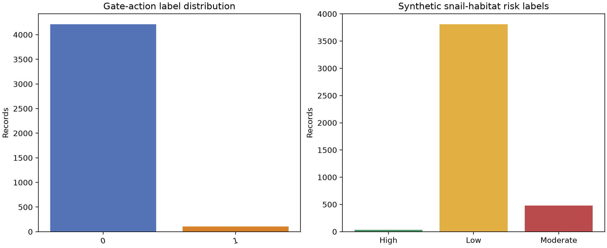
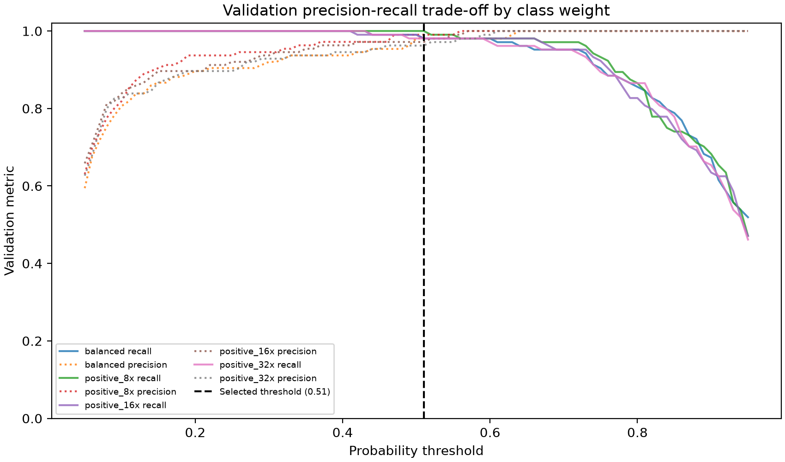
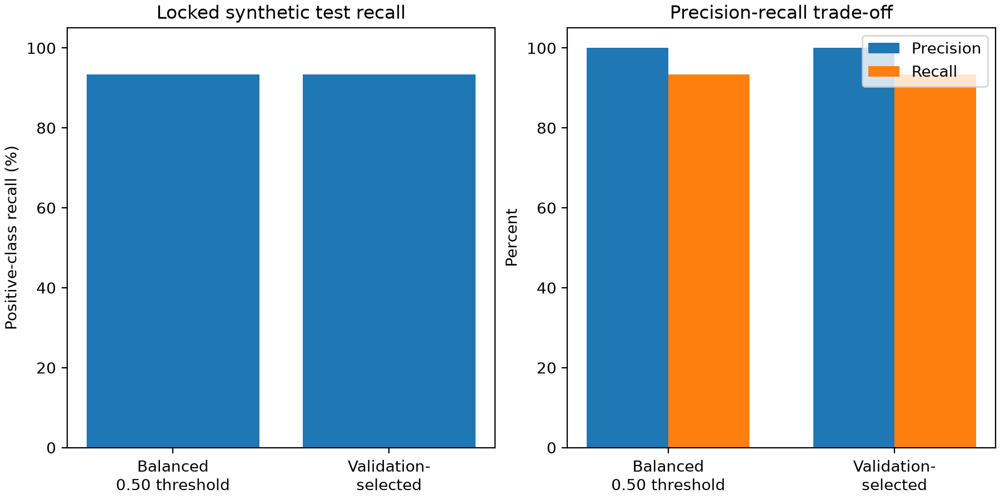
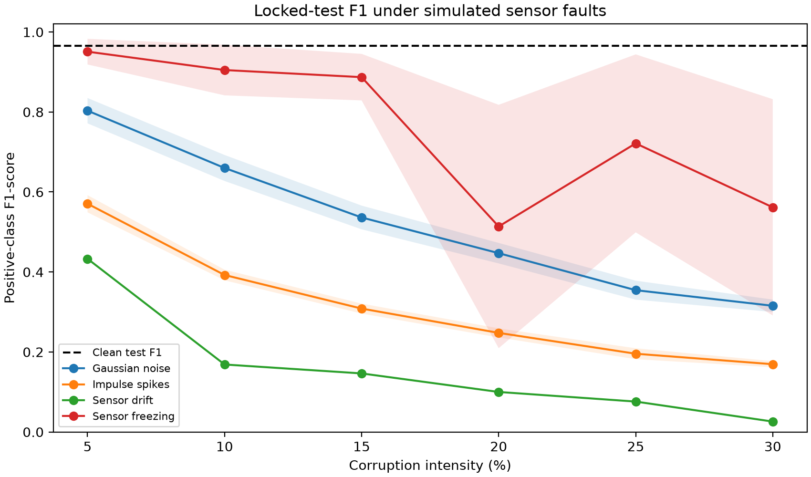
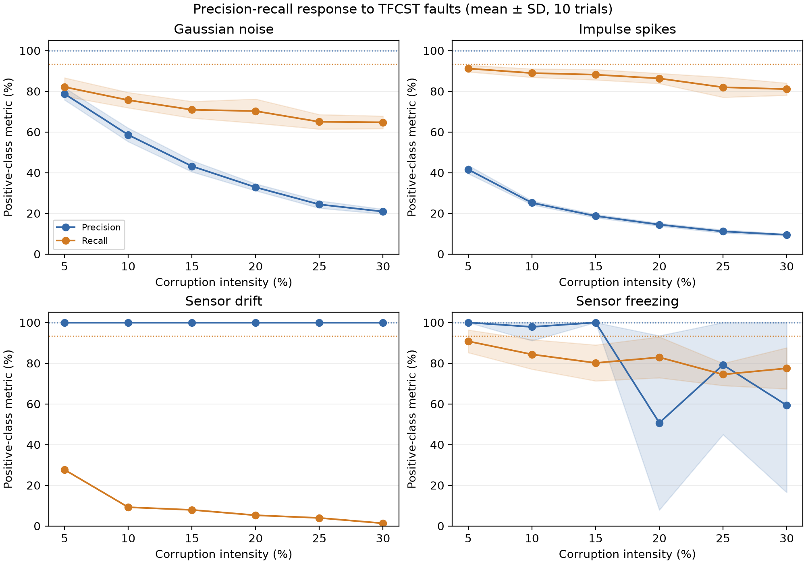
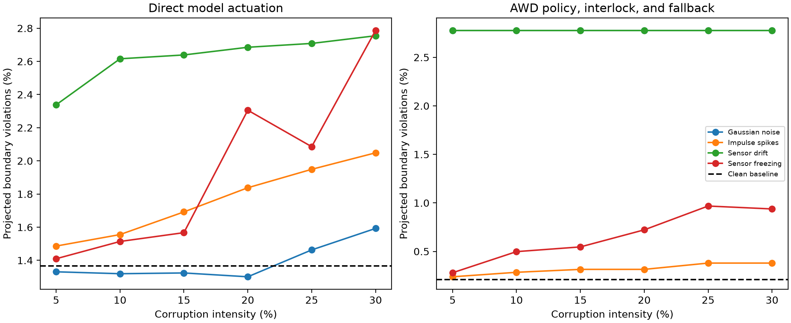

# CHAPTER 3

# RESULTS AND DISCUSSION

This chapter presents the results in the order of the study's Statement of the Problem (SOP 1–SOP 6). It reports the generated dataset profile and baseline prediction results, controlled TFCST sensor-corruption experiments, projected AWD boundary outcomes, software actuation-logic validation, and quality-assurance protocols derived from the measured degradation patterns.

The experiments establish a reproducible proof of concept for connecting sensor inputs, gate-action prediction, fault stress testing, and simulated safety logic. The training and evaluation labels were generated from configured rules, sensor faults were injected computationally, and gate response was projected using explicit one-hour assumptions. Accordingly, the quantitative conclusions characterize the implemented experimental system under those rules and assumptions. They provide a basis for engineering design and staged validation; they do not constitute measurements of field performance, farmer exposure, snail populations, disease incidence, greenhouse-gas emissions, or physical ESP32 actuation.

## 3.1 Baseline Dataset Profile and Predictive Performance (SOP 1 and SOP 2)

### 3.1.1 Dataset profile and label characteristics

The active dataset contains 4,320 hourly records covering a generated 180-day period from January 1, 2024, at 00:00 through June 28, 2024, at 23:00. Each record contains 12 predictors, the separate `Snail_Habitat_Risk` label, and the `AWD_Gate_Action` prediction target. The predictors describe temporal context (`Month`, `Day_of_Week`, and `Hour`), crop stage, hydrology and water quality, soil, and vegetation. The dataset has no missing values.

The records were generated using a fixed-seed simulation rather than collected from field sensors. The generator assigns crop stages on a repeating 120-day schedule and simulates water depth using drawdown cycles, crop stage, daily variation, a simplified seasonal rainfall factor, and random variation. Soil moisture is coupled to water depth and rainfall; soil temperature follows a daily solar pattern; and flow, pH, and vegetation measurements are generated from configured relationships and random variation. These internally related values make the dataset useful for controlled and reproducible model experiments.

`AWD_Gate_Action` encodes the simulated gate policy: `1` means open/reflood and `0` means close/maintain. During reproductive/flowering, the generator assigns an open action when water depth is below 2 cm. Outside flowering, it assigns an open action when water depth is at or below -15 cm or soil moisture is at or below 25%. The separate `Snail_Habitat_Risk` label uses configured environmental rules and is not included as a predictor in the gate-action model.

**Table 3.1. Selected descriptive statistics for the generated dataset**

| Variable | Unit | Minimum | Maximum | Mean |
|---|---:|---:|---:|---:|
| Water-table depth | cm | -16.811 | 5.374 | -4.136 |
| Inundation duration | days | 0.000 | 15.583 | 1.116 |
| Water-flow velocity | m/s | 0.000 | 0.350 | 0.148 |
| Water pH | pH | 6.028 | 7.405 | 6.750 |
| Soil moisture | % VWC | 20.684 | 80.959 | 53.732 |
| Soil temperature | °C | 19.819 | 32.997 | 25.427 |
| Vegetation coverage | % | 10.000 | 95.000 | 52.608 |
| Vegetation height | cm | 5.000 | 120.000 | 62.765 |

The generated gate-action target is imbalanced: 107 of 4,320 rows (2.48%) are positive open/reflood actions. The remaining 4,213 rows (97.52%) are close/maintain actions. The generated habitat-risk categories comprise 3,810 Low (88.19%), 478 Moderate (11.06%), and 32 High (0.74%) rows.

**Table 3.2. Generated label distribution**

| Label | Category | Records | Percentage |
|---|---|---:|---:|
| `AWD_Gate_Action` | 0 — close/maintain | 4,213 | 97.52% |
| `AWD_Gate_Action` | 1 — open/reflood | 107 | 2.48% |
| `Snail_Habitat_Risk` | Low | 3,810 | 88.19% |
| `Snail_Habitat_Risk` | Moderate | 478 | 11.06% |
| `Snail_Habitat_Risk` | High | 32 | 0.74% |

The label imbalance makes positive-class recall and the confusion matrix central measures of operational model behavior. In the intended control sequence, a positive prediction requests a gate action associated with the study's AWD thresholds; a missed positive is therefore a missed simulated reflood request. Precision is also important because false open/reflood predictions can create unnecessary actuation. Reporting both measures characterizes this trade-off more directly than accuracy alone.

The configured habitat-risk rules designate High risk when inundation exceeds 14 days, soil temperature is 15–30°C, pH is 5.5–7.9, and soil moisture is 20–80%. When that full rule is not met, Moderate risk is assigned for inundation exceeding 3 days, temperature 15–32°C, pH 5.3–8.1, and moisture 20–80%; other rows are Low. These defined ranges provide an explicit environmental context for the study's schistosomiasis-mitigation motivation. In this experiment they are rule-based habitat indicators, not observed *Oncomelania hupensis* presence or measured transmission outcomes.

### 3.1.2 Chronological baseline

The initial baseline used a chronological 80/20 split. The first 3,456 records were used for fitting and the final 864 later records were held out. The held-out segment contained 20 positive and 844 negative actions. The pipeline one-hot encoded `Month`, `Day_of_Week`, and `Crop_Growth_Stage`, passed numeric predictors through, and fitted a 400-tree Random Forest with balanced class weights and random seed 42.

**Table 3.3. Chronological held-out baseline performance**

| Metric | Result |
|---|---:|
| Accuracy | 98.50% |
| Precision | 88.89% |
| Recall | 40.00% |
| F1-score | 55.17% |

**Table 3.4. Confusion matrix for the chronological baseline**

| Actual class | Predicted 0 | Predicted 1 |
|---|---:|---:|
| 0 — close/maintain | 843 | 1 |
| 1 — open/reflood | 12 | 8 |

The model identified 8 of the 20 positive actions and missed 12. Although its accuracy was 98.50%, its 40.00% recall shows that accuracy alone does not characterize performance on the rare action class. This chronological result establishes a demanding baseline and motivates explicit validation-based model selection rather than reliance on the majority-class score.

### 3.1.3 Validation-based model and threshold selection

A separate experiment evaluated whether class weighting and decision-threshold selection could improve the recall-focused operating point without tuning against the final test records. Four generated realizations (seeds 42–45; 17,280 records combined) were used for model fitting. Four class-weight settings—balanced, positive-class weight 8, 16, and 32—were evaluated on validation seed 46 (4,320 records, including 104 positive actions). Thresholds from 0.05 to 0.95, in 0.01 increments, were compared using positive-class F2-score, which gives greater weight to recall than precision. Ties were resolved by higher precision and then the higher threshold.

The selected configuration was positive-class weight 8 and a probability threshold of 0.51. On validation data, it achieved 100.00% recall, 99.05% precision, and 99.81% F2-score. The balanced model at its default 0.50 threshold achieved 99.04% recall, 98.10% precision, and 98.85% F2-score on the same validation realization.

**Table 3.5. Locked-test performance after validation-only selection**

| Metric | Balanced model, threshold 0.50 | Selected model, threshold 0.51 |
|---|---:|---:|
| Accuracy | 99.88% | 99.88% |
| Precision | 100.00% | 100.00% |
| Recall | 93.42% | 93.42% |
| F1-score | 96.60% | 96.60% |
| F2-score | 94.67% | 94.67% |
| True negatives | 4,244 | 4,244 |
| False positives | 0 | 0 |
| False negatives | 5 | 5 |
| True positives | 71 | 71 |

The locked test was generated with seed 47 and contained 4,320 records, including 76 positive actions. Model and threshold selection were completed on training and validation realizations before the locked-test comparison. The selected model and balanced default model produced identical test predictions. Thus, validation-based tuning improved the validation operating point but did not improve test metrics over the default baseline. This test result is retained as measured; the configuration was not changed after examining it.

The chronological and seeded evaluations address different experimental conditions. The chronological holdout measures performance on the later portion of the original generated sequence, while the locked test measures performance on another random realization from the same generator. The latter supports reproducibility across generated realizations under the configured rules. Because the features and labels share those rules, these classification results measure how well the model approximates the simulated decision policy; they do not independently verify the policy's agronomic suitability.

In practical system terms, the classifier is the decision component between environmental measurements and a requested gate action. The study's adviser-approved, IRRI-aligned AWD envelope is a lower water-depth limit of -15 cm outside flowering and an upper limit of +5 cm, with a flowering minimum above 0 cm. The measured classification results demonstrate that a supervised model can reproduce the generated action policy with high recall on the locked generated test. They therefore support the model's role as a proof-of-concept decision component within this synthetic control pipeline. The tests do not measure farmer contact or establish that water-level control changes snail abundance or disease incidence.

## 3.2 TFCST Environmental Noise Degradation Analysis (SOP 3)

The validation-selected model (positive-class weight 8, probability threshold 0.51) was tested under four controlled sensor-fault profiles: Gaussian noise, impulse spikes, sensor drift, and sensor freezing. Each profile was applied at 5%, 10%, 15%, 20%, 25%, and 30% intensity. Fault injection was limited to the direct numeric sensor channels; calendar `Hour`, categorical context, and generator-derived `Inundation_Duration_Days` were left unchanged. Ten seeded corruption trials were performed for each fault-intensity condition on the fixed seed-47 test realization. Table 3.6 reports the mean and standard deviation of positive-class precision, recall, and F1-score across trials. The model and threshold remained fixed; variation therefore reflects the fault-injection realizations.

**Table 3.6. Locked-test classification under simulated sensor corruption (mean ± SD, %)**

| Fault profile | Intensity | Precision | Recall | F1-score |
|---|---:|---:|---:|---:|
| Gaussian noise | 5% | 78.7 ± 3.0 | 82.1 ± 4.5 | 80.3 ± 3.2 |
| Gaussian noise | 10% | 58.6 ± 3.3 | 75.7 ± 3.8 | 66.0 ± 3.3 |
| Gaussian noise | 15% | 43.2 ± 2.8 | 70.9 ± 4.1 | 53.6 ± 3.0 |
| Gaussian noise | 20% | 32.8 ± 1.7 | 70.3 ± 5.9 | 44.7 ± 2.6 |
| Gaussian noise | 25% | 24.4 ± 1.8 | 65.0 ± 3.6 | 35.4 ± 2.4 |
| Gaussian noise | 30% | 20.9 ± 1.2 | 64.7 ± 3.1 | 31.5 ± 1.5 |
| Impulse spikes | 5% | 41.5 ± 2.0 | 91.2 ± 1.6 | 57.1 ± 2.1 |
| Impulse spikes | 10% | 25.2 ± 1.0 | 88.9 ± 2.1 | 39.2 ± 1.3 |
| Impulse spikes | 15% | 18.7 ± 0.8 | 88.2 ± 2.6 | 30.8 ± 1.2 |
| Impulse spikes | 20% | 14.5 ± 0.7 | 86.3 ± 2.5 | 24.8 ± 1.1 |
| Impulse spikes | 25% | 11.1 ± 0.8 | 82.0 ± 4.9 | 19.6 ± 1.4 |
| Impulse spikes | 30% | 9.5 ± 0.4 | 81.1 ± 3.0 | 16.9 ± 0.8 |
| Sensor drift | 5% | 100.0 ± 0.0 | 27.6 ± 0.0 | 43.3 ± 0.0 |
| Sensor drift | 10% | 100.0 ± 0.0 | 9.2 ± 0.0 | 16.9 ± 0.0 |
| Sensor drift | 15% | 100.0 ± 0.0 | 7.9 ± 0.0 | 14.6 ± 0.0 |
| Sensor drift | 20% | 100.0 ± 0.0 | 5.3 ± 0.0 | 10.0 ± 0.0 |
| Sensor drift | 25% | 100.0 ± 0.0 | 3.9 ± 0.0 | 7.6 ± 0.0 |
| Sensor drift | 30% | 100.0 ± 0.0 | 1.3 ± 0.0 | 2.6 ± 0.0 |
| Sensor freezing | 5% | 100.0 ± 0.0 | 90.8 ± 5.6 | 95.1 ± 3.2 |
| Sensor freezing | 10% | 97.9 ± 6.8 | 84.3 ± 7.3 | 90.5 ± 6.3 |
| Sensor freezing | 15% | 100.0 ± 0.0 | 80.1 ± 8.8 | 88.7 ± 5.8 |
| Sensor freezing | 20% | 50.7 ± 42.8 | 82.9 ± 10.1 | 51.4 ± 30.4 |
| Sensor freezing | 25% | 79.2 ± 34.2 | 74.5 ± 5.4 | 72.2 ± 22.3 |
| Sensor freezing | 30% | 59.3 ± 42.9 | 77.5 ± 10.1 | 56.2 ± 27.0 |

The fault profiles produce distinct engineering signatures. Gaussian noise progressively reduces precision and F1, while recall remains comparatively higher through the tested range. Impulse spikes preserve relatively high recall but sharply reduce precision; at 30% intensity, precision averages 9.46%, indicating that most predicted open/reflood actions are false positives in this generated test. Sensor freezing is already variable at 5%, with much larger variability at higher intensities; the 20% condition has a mean F1 of 51.37% and a 30.42 percentage-point standard deviation. Sensor drift is the most consequential profile for missed positive actions: recall falls from 27.63% at 5% drift to 9.21% at 10% and 1.32% at 30%, while F1 falls from 43.30% to 16.87% and 2.60%, respectively.

The degradation curves provide quantitative evidence for fault-specific monitoring. Drift requires particular attention because the model can remain highly precise while failing to identify most positive actions. Impulse spikes call for a complementary strategy that limits spurious gate requests, and freezing calls for temporal consistency checks. The exact percentages describe the defined injector and provide controlled stress-test levels for engineering decisions; they are not direct calibration-error measurements for a deployed sensor.

Figure 3.6 makes the fault-specific performance trade-off explicit. Under drift, precision remains at 100% while recall falls sharply, indicating that the classifier becomes increasingly conservative and misses positive actions. Under impulse spikes, recall remains comparatively high while precision declines, indicating an increasing rate of false open/reflood predictions. The side-by-side profiles support separate monitoring and mitigation strategies for missed actions and false actuation rather than a single global accuracy threshold.

## 3.3 Failure Threshold and AWD Boundary Violation Analysis (SOP 4)

The boundary experiment uses the adviser-approved, IRRI-aligned AWD assumptions: outside flowering, water depth is maintained between -15 cm and +5 cm; during flowering, water depth is maintained above 0 cm and below the +5 cm upper bound. For one-hour projections, an open gate increases depth by 1.0 cm and a closed gate decreases depth by 0.5 cm. These response rates define the simulated actuator model used to compare direct predictions with interlocked actions.

The tuned model's fault-free locked test produced 59 projected boundary violations across 4,320 records (1.37%). Applying the one-step interlock reduced this count to 9 (0.21%). Under each injected fault, ten trials measured the average direct and interlocked violation counts. Table 3.7 shows selected levels; full per-level results are in the experiment output directory.

**Table 3.7. Selected projected AWD boundary violation results**

| Fault profile | Intensity | Direct violations (mean records) | Direct rate | Interlocked violations (mean records) | Interlocked rate |
|---|---:|---:|---:|---:|---:|
| Clean baseline | 0% | 59.0 | 1.37% | 9.0 | 0.21% |
| Gaussian noise | 5% | 57.5 | 1.33% | 120.0 | 2.78% |
| Gaussian noise | 30% | 68.8 | 1.59% | 120.0 | 2.78% |
| Impulse spikes | 5% | 64.2 | 1.49% | 10.2 | 0.24% |
| Impulse spikes | 30% | 88.5 | 2.05% | 16.6 | 0.38% |
| Sensor drift | 5% | 101.0 | 2.34% | 120.0 | 2.78% |
| Sensor drift | 30% | 119.0 | 2.75% | 120.0 | 2.78% |
| Sensor freezing | 5% | 60.9 | 1.41% | 12.1 | 0.28% |
| Sensor freezing | 30% | 120.4 | 2.79% | 40.5 | 0.94% |

For the selected model, the first tested drift condition already produces substantial positive-action degradation: recall is 27.63% at 5% drift. By 10% drift, recall is 9.21% and F1 is 16.87%; at 30%, recall is 1.32%. These are the measured stress levels at which the model's ability to identify positive actions becomes severely limited. They pinpoint a practical breaking region in the tested drift profile and demonstrate why sensor calibration monitoring and automatic fault response are needed. This boundary is specific to the implemented model, generator, and fault injector.

The interlock reduces projected violations on clean inputs, from 59 to 9 records. For Gaussian noise and drift, the fallback enters safe mode on all rows in this experiment because the injector marks every row as affected. It holds the initial closed command, resulting in 120 projected flowering-boundary violations (2.78%). This outcome identifies an engineering requirement: a fallback state must be selected with crop stage and physical water conditions in view, rather than assuming that holding the previous command alone guarantees boundary compliance. The simulation makes this requirement measurable for the next controller design iteration.

The study's habitat-risk criteria provide a public-health motivation for maintaining appropriate agricultural water conditions. In the generator, the High-risk category is associated with prolonged inundation and specified ranges of moisture, temperature, and pH. The experiment evaluates gate-action prediction and projected AWD depth boundaries; it does not model greenhouse-gas emissions, observed snail ecology, or epidemiological response. Accordingly, Table 3.7 reports AWD boundary outcomes, not measured disruption of snail breeding. Ecological and field outcomes are appropriate targets for subsequent evaluation.

## 3.4 Embedded Logic and Microcontroller Actuation Simulation (SOP 5)

The control module implements a software-level actuation sequence designed to be portable to an embedded controller. For each reading, it checks freshness, required fields, numerical validity and range, categorical values, and repeated sensor values. Invalid or flagged readings enter safe mode, retain the last gate command, and return a reason code. For valid readings, the safety interlock evaluates the one-hour projected depth and may override a requested gate action to avoid crossing the configured AWD limits.

The Python simulation was exercised using clean and corrupted sensor streams, predicted gate commands, the simulated water state, and the interlock/fallback logic. The clean-test projection reduced the boundary-violation count from 59 to 9. The stress tests also exposed a limitation of the current hold-last-command behavior under faults: when the simulated initial gate state is closed, a fault flag across all Gaussian-noise or drift rows leaves the gate closed, producing 120 projected flowering-boundary violations. The result provides a concrete controller-design case for evaluating crop-stage-aware fallback commands.

Twelve automated tests passed. They cover deterministic corruption, generated-seed consistency, threshold selection, explicit threshold use by the prediction helper, stale and invalid readings, fault flags, repeated-value detection, and lower/upper-boundary interlocks. These results validate the implemented Python logic and its expected software behavior.

An initial PlatformIO/Wokwi project has been added under `wokwi/`. Its firmware represents the controller validity checks, safe-mode state, and AWD interlock using serial-injected test readings and virtual LEDs for gate and safe-mode states. The requested gate action is supplied as a test input; the Random Forest is not embedded in this firmware. This scope makes the project suitable for testing the actuation-logic path separately from the Python classifier.

The project has not yet been compiled or run in Wokwi. PlatformIO stalled while downloading the ESP32 toolchain, and the Wokwi VS Code extension is not installed in the current environment. Consequently, the results in this chapter remain Python software-in-the-loop results; no ESP32 timing, memory, hardware-in-the-loop, or Wokwi simulation result is reported. Completing the embedded build and simulator run is the next SOP 5 validation task.

The proposed automation is intended to reduce the need for routine direct farmer interaction with a gate by supporting sensor-informed actuation. The current experiment does not measure human exposure or demonstrate zero-contact operation; that outcome depends on successful hardware integration, reliable communications, actuator safeguards, and an appropriate manual override and maintenance process.

## 3.5 CRISP-ML(Q) Quality Assurance and Data-Driven Maintenance Protocols (SOP 6)

The empirical degradation thresholds under TFCST provide quantitative, data-driven boundaries for establishing sensor recalibration cycles and automated fallback protocols. In this experiment, the injected percentages are controlled perturbation levels rather than elapsed-time drift measurements. They therefore support magnitude-based QA triggers and acceptance testing; a calendar-based recalibration interval should be set after measuring how quickly deployed sensors accumulate comparable error.

**Table 3.8. TFCST evidence translated into QA and maintenance actions**

| Condition / measured evidence | Proposed QA trigger | Engineering response |
|---|---|---|
| Sensor drift at 5%: recall 27.63%; F1 43.30% | Early-warning level for calibration investigation in acceptance testing | Compare sensor readings with a calibrated reference; investigate offset and trend; repeat model validation after recalibration. |
| Sensor drift at 10%: recall 9.21%; F1 16.87% | Critical stress-test boundary for model-only action | Flag the sensor and suspend unverified model-only commands; enter the approved fallback and request inspection/recalibration. |
| Gaussian noise at 30%: precision 20.87%; recall 64.74%; F1 31.55% | Severe-noise benchmark for robustness testing | Check signal quality and shielding/filtering; rerun the noise stress test and verify the selected decision threshold. |
| Impulse spikes at 30%: precision 9.46%; recall 81.05%; F1 16.94% | False-actuation stress condition | Add range/plausibility and transient-spike checks; confirm that isolated spikes cannot trigger repeated gate commands. |
| Sensor freezing at 20%: F1 51.37% ± 30.42 percentage points | High-variability condition requiring detection testing | Check temporal change; invoke safe mode when the implemented repeated-value rule is met; inspect sensor and communications. |
| Clean one-hour interlock: violations reduced from 59 (1.37%) to 9 (0.21%) | Controller regression-test baseline | Preserve the interlock and verify it against both AWD boundaries and crop-stage-specific limits after every controller change. |
| Stale, missing, invalid, or repeated readings | Implemented software checks: age over 3,600 s; invalid/missing values; or three consecutive identical sensor readings | Enter safe mode, hold the previous command, and return the diagnostic reason for operator review. |

The drift percentages in Table 3.8 are magnitude-based triggers for controlled testing, not calibrated sensor tolerances or elapsed-time service intervals. The response column specifies proposed QA actions; drift- and noise-specific online detection is not established by the current controller. The existing controller implements input-validity checks, externally supplied fault flags, and repeated-value detection. A deployment maintenance calendar should be set by monitoring sensor residuals over time and relating those measurements to the stress-test levels.

The following protocols translate the measured behavior into an engineering QA workflow:

1. **Use 5% drift as an early calibration-investigation trigger.** At this first tested drift level, recall declined to 27.63% and F1 to 43.30%, from 93.42% recall and 96.60% F1 on clean locked-test inputs. The system should flag sensor calibration review at or before this stress level during controlled acceptance tests. Field thresholds should be expressed in each sensor's engineering units after calibration data are available.
2. **Use 10% drift as a critical fallback and recalibration boundary in the stress-test plan.** At 10% simulated drift, recall was 9.21% and F1 was 16.87%. The QA response should prevent unverified model commands from being treated as normal control at or beyond this tested condition; the monitoring system should flag the sensor, retain a defined safe state, and request operator review or sensor recalibration. The percentage is a simulator-specific trigger, not a universal device tolerance.
3. **Apply fault-specific protections.** Gaussian noise progressively degrades F1; impulse spikes chiefly undermine precision; and freezing produces run-to-run variability. QA should therefore combine range and plausibility checks, transient-spike filtering, and temporal change detection rather than relying on a single aggregate accuracy metric.
4. **Trigger safe mode for invalid, stale, or frozen readings.** The implemented controller treats readings older than 3,600 seconds, missing or non-finite values, out-of-range values, invalid categories, externally flagged faults, and three consecutive identical numeric sensor readings as safe-mode conditions. It holds the prior command and returns a diagnostic reason. These configured conditions can serve as the initial software acceptance criteria for the prototype.
5. **Make fallback behavior crop-stage and boundary aware.** Clean interlock projections reduced boundary violations, while closed-command hold behavior produced violations for simulated flowering states under Gaussian noise and drift. The next control iteration should compare candidate fallback states using crop stage and measured water depth, then test them against the same lower and upper AWD limits across all fault profiles.
6. **Track minority-class performance as a release criterion.** Record positive-class recall, precision, F1/F2, false-positive actions, false-negative actions, and projected boundary violations for each model and sensor configuration. The seed-47 result (93.42% recall) and the original chronological result (40.00% recall) show why release decisions should consider the evaluation split and target support, not accuracy alone.
7. **Derive service intervals from measured sensor history.** The stress-test percentages identify error magnitudes associated with degradation, while repeated controlled trials characterize sensitivity to fault realizations. Recording real sensor residuals over time will convert these magnitude triggers into evidence-based recalibration cycles and maintenance scheduling.
8. **Progress validation through deployment stages.** Retain the reproducible synthetic tests as regression tests, implement and measure the controller on ESP32/Wokwi, then evaluate it with calibrated sensors, representative paddy conditions, observed gate actions, and ecological outcomes. This staged QA sequence links model quality, sensor integrity, actuation, and the study's public-health motivation.

The next validation stages are to complete and run the ESP32/Wokwi controller demonstration; bench-test calibrated sensors and actuator response, including communications loss and manual override; and then conduct a supervised, limited field pilot with independent-period evaluation. A later agronomic and public-health study should pair water-management records with defined observations of habitat conditions and snail outcomes; greenhouse-gas effects require a separate measurement protocol if retained as a research claim. Before each stage, define acceptance limits for sensor error, sampling interval, actuator behavior, false-positive and false-negative actions, boundary violations, and stop conditions. Retain seeds, configurations, logs, reference measurements, commanded and observed gate states, and interventions so that each progression decision is reproducible and auditable. The ESP32/Wokwi scaffold exists, but it has not yet been compiled or run; the present evidence remains a reproducible Python proof of concept with quantified synthetic stress-test behavior.

Within the configured habitat rules, water management is connected to environmental conditions relevant to *Oncomelania hupensis*: soil moisture of 20–80%, temperature of 15–30°C, pH of 5.5–7.9, and prolonged inundation are inputs to the synthetic High-risk label. The system's potential public-health contribution is therefore a testable engineering hypothesis: reliable sensor-informed AWD operation may alter conditions represented by the habitat-risk rules while reducing the need for routine gate contact. Establishing the ecological effect requires linking actual water management to observed snail habitat and population outcomes. The present results provide an initial quantitative basis for designing that evaluation.

## Chapter Summary

The chapter established the model's baseline behavior and evaluated its robustness under controlled synthetic sensor faults. The chronological baseline achieved 98.50% accuracy and 40.00% recall on 864 held-out records. A separate validation-based experiment selected an 8× positive-class weight and a 0.51 threshold; on an untouched generated test realization it achieved 99.88% accuracy, 93.42% recall, and 100% precision. The selected model produced the same test predictions as the balanced default, and this result is reported without post-test adjustment.

TFCST stress testing identified sensor drift as the most consequential fault for missed positive gate actions: recall fell to 27.63% at 5% drift and 9.21% at 10%. These thresholds establish quantitative calibration-investigation and fallback test points for the prototype. The one-hour interlock reduced clean projected AWD violations from 59 to 9, while faulted closed-command fallback cases identified the need for a crop-stage-aware fallback policy. Twelve software tests passed. The findings support the feasibility of the synthetic decision-and-control workflow and provide actionable QA priorities; physical microcontroller execution, calibrated field measurements, and ecological outcome assessment are subsequent stages required to quantify performance beyond the current simulation.

## Reproducibility

The initial chronological experiment can be rerun using `python src/chapter3_experiments.py --repeats 10`; its outputs are under `reports/chapter3_experiments/`. The validation-tuned experiment can be rerun using `python -m src.tune_gate_model --repeats 10`; its model, tables, and figures are under `reports/chapter3_tuning/`. The tuning procedure uses generated seeds 42–45 for training, seed 46 for validation, and seed 47 for the locked test. Sensor corruption is tested at 5–30% in 5-point increments with ten repeats per condition. The one-hour actuator response and AWD boundaries are the configured simulation assumptions documented with the experiment outputs. The ESP32/Wokwi source scaffold is in `wokwi/`; compilation and simulation have not yet been verified.
