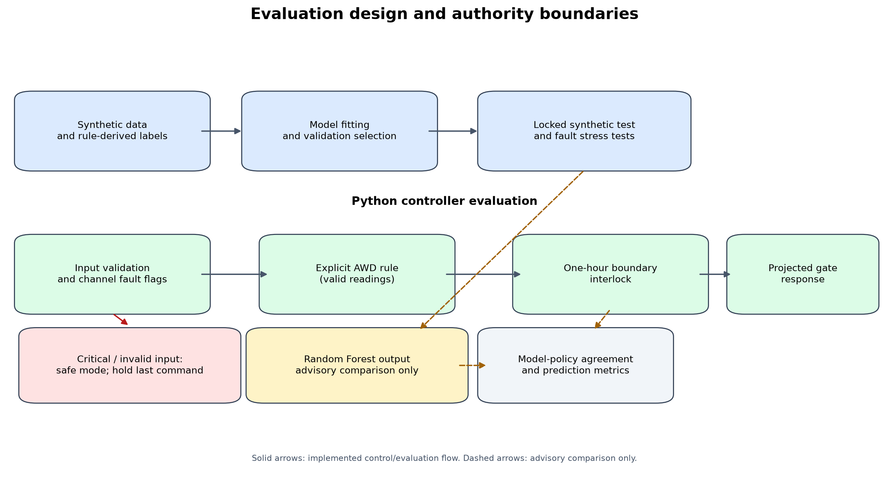
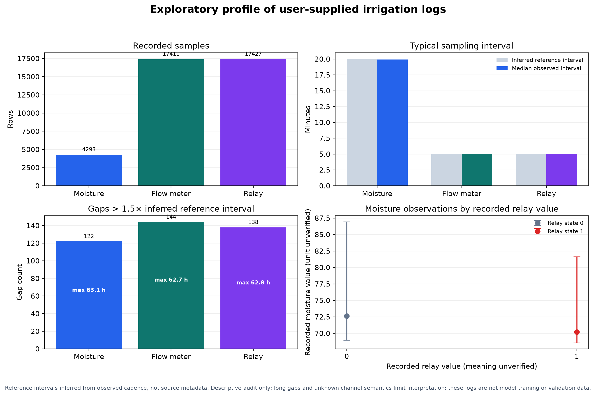

# CHAPTER 3

# RESULTS AND DISCUSSION

This chapter reports the study's results in relation to SOP 1–SOP 6: dataset and model performance, controlled sensor-fault stress tests, projected AWD boundary behavior, controller software checks, and a staged quality-assurance plan. The study's principal engineering contribution is a reproducible Python prototype that separates advisory machine-learning predictions from an explicit AWD policy, tests channel-aware fault routing, and measures one-hour boundary projections under documented assumptions.

The results are strongest as software and simulation evidence. The active training and test labels come from configured rules; injected faults are controlled perturbations; and projected water-depth changes use simulated actuator rates. A separate audit now describes the user-supplied irrigation sensor/relay logs without using them for model training or scoring. Together, these outputs clarify what the prototype does, identify the conditions that need further engineering work, and provide repeatable tests for the next validation stage. They do not estimate farm effectiveness, ecological or epidemiological outcomes, or physical ESP32 performance.

## 3.1 Baseline Dataset Profile and Predictive Performance (SOP 1 and SOP 2)

### 3.1.1 Dataset profile and label characteristics

The active dataset contains 4,320 hourly records covering a generated 180-day period from January 1, 2024, at 00:00 through June 28, 2024, at 23:00. Each record contains 12 predictors, the separate `Snail_Habitat_Risk` label, and the `AWD_Gate_Action` prediction target. The predictors describe temporal context (`Month`, `Day_of_Week`, and `Hour`), crop stage, hydrology and water quality, soil, and vegetation. The dataset has no missing values.

The records were generated using a fixed-seed simulation rather than collected from field sensors. The generator assigns crop stages on a repeating 120-day schedule and simulates water depth using drawdown cycles, crop stage, daily variation, a simplified seasonal rainfall factor, and random variation. Soil moisture is coupled to water depth and rainfall; soil temperature follows a daily solar pattern; and flow, pH, and vegetation measurements are generated from configured relationships and random variation. This shared generator provides a stable benchmark for controlled comparisons and repeatable software tests.

`AWD_Gate_Action` encodes the simulated gate policy: `1` means open/reflood and `0` means close/maintain. During reproductive/flowering, the generator assigns an open action when water depth is below 2 cm. Outside flowering, it assigns an open action when water depth is at or below -15 cm or soil moisture is at or below 25%. The separate `Snail_Habitat_Risk` label uses configured environmental rules and is not included as a predictor in the gate-action model.

**Table 3.1. Selected descriptive statistics for the generated dataset**

| Variable | Unit | Minimum | Maximum | Mean |
|---|---:|---:|---:|---:|
| Water-table depth | cm | -16.811 | 5.374 | -4.136 |
| Inundation duration | days | 0.000 | 15.583 | 1.116 |
| Water-flow velocity | m/s | 0.000 | 0.350 | 0.148 |
| Water pH | pH | 6.028 | 7.405 | 6.750 |
| Soil moisture | % VWC | 20.684 | 80.959 | 53.732 |
| Soil temperature | °C | 19.819 | 32.997 | 25.427 |
| Vegetation coverage | % | 10.000 | 95.000 | 52.608 |
| Vegetation height | cm | 5.000 | 120.000 | 62.765 |

The generated gate-action target is imbalanced: 107 of 4,320 rows (2.48%) are positive open/reflood actions. The remaining 4,213 rows (97.52%) are close/maintain actions. The generated habitat-risk categories comprise 3,810 Low (88.19%), 478 Moderate (11.06%), and 32 High (0.74%) rows.

**Table 3.2. Generated label distribution**

| Label | Category | Records | Percentage |
|---|---|---:|---:|
| `AWD_Gate_Action` | 0 — close/maintain | 4,213 | 97.52% |
| `AWD_Gate_Action` | 1 — open/reflood | 107 | 2.48% |
| `Snail_Habitat_Risk` | Low | 3,810 | 88.19% |
| `Snail_Habitat_Risk` | Moderate | 478 | 11.06% |
| `Snail_Habitat_Risk` | High | 32 | 0.74% |

Because positive actions account for only 2.48% of generated records, accuracy alone is not informative about the rarer action. Positive-class recall measures how many generated reflood requests are identified; precision measures how many positive predictions correspond to generated requests. Both are reported alongside accuracy and the confusion matrix.

The configured habitat-risk rules designate High risk when inundation exceeds 14 days, soil temperature is 15–30°C, pH is 5.5–7.9, and soil moisture is 20–80%. When that full rule is not met, Moderate risk is assigned for inundation exceeding 3 days, temperature 15–32°C, pH 5.3–8.1, and moisture 20–80%; other rows are Low. These rules make the study's environmental motivation explicit and reproducible. Their output is a simulated habitat indicator, not an observation of *Oncomelania hupensis* or disease transmission.

### 3.1.2 Chronological baseline

The initial baseline used a chronological 80/20 split. The first 3,456 records were used for fitting and the final 864 later records were held out. The held-out segment contained 20 positive and 844 negative actions. The pipeline one-hot encoded `Month`, `Day_of_Week`, and `Crop_Growth_Stage`, passed numeric predictors through, and fitted a 400-tree Random Forest with balanced class weights and random seed 42.

**Table 3.3. Chronological held-out baseline performance**

| Metric | Result |
|---|---:|
| Accuracy | 98.50% |
| Precision | 88.89% |
| Recall | 40.00% |
| F1-score | 55.17% |

**Table 3.4. Confusion matrix for the chronological baseline**

| Actual class | Predicted 0 | Predicted 1 |
|---|---:|---:|
| 0 — close/maintain | 843 | 1 |
| 1 — open/reflood | 12 | 8 |

The model identified 8 of the 20 positive actions in this chronological test. This establishes a useful initial reference: on this split, the balanced default threshold was conservative for the rare positive class. The result motivated a separate experiment in which class weighting and decision threshold were selected on generated validation data, without using the locked test for tuning.

### 3.1.3 Validation-based model and threshold selection

A separate experiment tested validation-based operating-point selection. Four generated realizations (seeds 42–45; 17,280 records combined) were used for fitting. Four class-weight settings—balanced, positive-class weight 8, 16, and 32—were evaluated on validation seed 46 (4,320 records, including 104 positive actions). Thresholds from 0.05 to 0.95, in 0.01 increments, were compared using positive-class F2-score, which weights recall more heavily than precision. Ties were resolved by higher precision and then the higher threshold.

The selected validation configuration was positive-class weight 8 and probability threshold 0.51. It achieved 100.00% recall, 99.05% precision, and 99.81% F2-score on seed 46. The validation comparison is shown in Figure 3.2. This is a validation result under the synthetic generator, not a field-performance estimate.

The selected and default models produced identical predictions on locked seed 47. Both achieved 99.88% accuracy, 100.00% precision, and 93.42% recall (71 true positives and 5 false negatives among 76 positive records), as shown in Table 3.5 and Figure 3.3. Thus, the selection procedure improved the validation operating point, but did not demonstrate an improvement over the balanced default on this particular locked test. Reporting this comparison avoids overstating the effect of tuning.

**Table 3.5. Locked-test performance after validation-only selection**

| Metric | Balanced model, threshold 0.50 | Selected model, threshold 0.51 |
|---|---:|---:|
| Accuracy | 99.88% | 99.88% |
| Precision | 100.00% | 100.00% |
| Recall | 93.42% | 93.42% |
| F1-score | 96.60% | 96.60% |
| F2-score | 94.67% | 94.67% |
| True negatives | 4,244 | 4,244 |
| False positives | 0 | 0 |
| False negatives | 5 | 5 |
| True positives | 71 | 71 |

The locked test used seed 47 and contained 4,320 records, including 76 positive actions. Model and threshold selection were completed before this test was evaluated. The agreement of the two models is evidence of reproducibility within this generator setup, not evidence that the classifier generalizes to a farm or to a different data source.

## 3.2 TFCST Sensor-Fault Robustness Analysis (SOP 3)

The validation-selected model (positive-class weight 8, probability threshold 0.51) was tested under four controlled sensor-fault profiles: Gaussian noise, impulse spikes, sensor drift, and sensor freezing. Each profile was applied at 5%, 10%, 15%, 20%, 25%, and 30% intensity. Fault injection was limited to the direct numeric sensor channels; calendar `Hour`, categorical context, and generator-derived `Inundation_Duration_Days` were left unchanged. Ten seeded corruption trials were performed for each fault-intensity condition on the fixed seed-47 test realization. Table 3.6 reports the mean and standard deviation of positive-class precision, recall, and F1-score across trials. The model and threshold remained fixed; variation therefore reflects the fault-injection realizations.

**Table 3.6. Locked-test classification under simulated sensor corruption (mean ± SD, %)**

| Fault profile | Intensity | Precision | Recall | F1-score |
|---|---:|---:|---:|---:|
| Gaussian noise | 5% | 78.7 ± 3.0 | 82.1 ± 4.5 | 80.3 ± 3.2 |
| Gaussian noise | 10% | 58.6 ± 3.3 | 75.7 ± 3.8 | 66.0 ± 3.3 |
| Gaussian noise | 15% | 43.2 ± 2.8 | 70.9 ± 4.1 | 53.6 ± 3.0 |
| Gaussian noise | 20% | 32.8 ± 1.7 | 70.3 ± 5.9 | 44.7 ± 2.6 |
| Gaussian noise | 25% | 24.4 ± 1.8 | 65.0 ± 3.6 | 35.4 ± 2.4 |
| Gaussian noise | 30% | 20.9 ± 1.2 | 64.7 ± 3.1 | 31.5 ± 1.5 |
| Impulse spikes | 5% | 41.5 ± 2.0 | 91.2 ± 1.6 | 57.1 ± 2.1 |
| Impulse spikes | 10% | 25.2 ± 1.0 | 88.9 ± 2.1 | 39.2 ± 1.3 |
| Impulse spikes | 15% | 18.7 ± 0.8 | 88.2 ± 2.6 | 30.8 ± 1.2 |
| Impulse spikes | 20% | 14.5 ± 0.7 | 86.3 ± 2.5 | 24.8 ± 1.1 |
| Impulse spikes | 25% | 11.1 ± 0.8 | 82.0 ± 4.9 | 19.6 ± 1.4 |
| Impulse spikes | 30% | 9.5 ± 0.4 | 81.1 ± 3.0 | 16.9 ± 0.8 |
| Sensor drift | 5% | 100.0 ± 0.0 | 27.6 ± 0.0 | 43.3 ± 0.0 |
| Sensor drift | 10% | 100.0 ± 0.0 | 9.2 ± 0.0 | 16.9 ± 0.0 |
| Sensor drift | 15% | 100.0 ± 0.0 | 7.9 ± 0.0 | 14.6 ± 0.0 |
| Sensor drift | 20% | 100.0 ± 0.0 | 5.3 ± 0.0 | 10.0 ± 0.0 |
| Sensor drift | 25% | 100.0 ± 0.0 | 3.9 ± 0.0 | 7.6 ± 0.0 |
| Sensor drift | 30% | 100.0 ± 0.0 | 1.3 ± 0.0 | 2.6 ± 0.0 |
| Sensor freezing | 5% | 100.0 ± 0.0 | 90.8 ± 5.6 | 95.1 ± 3.2 |
| Sensor freezing | 10% | 97.9 ± 6.8 | 84.3 ± 7.3 | 90.5 ± 6.3 |
| Sensor freezing | 15% | 100.0 ± 0.0 | 80.1 ± 8.8 | 88.7 ± 5.8 |
| Sensor freezing | 20% | 50.7 ± 42.8 | 82.9 ± 10.1 | 51.4 ± 30.4 |
| Sensor freezing | 25% | 79.2 ± 34.2 | 74.5 ± 5.4 | 72.2 ± 22.3 |
| Sensor freezing | 30% | 59.3 ± 42.9 | 77.5 ± 10.1 | 56.2 ± 27.0 |

The four profiles show different effects on the two action classes. Gaussian noise progressively lowers precision and F1 while recall remains higher across the tested levels. Impulse spikes preserve more recall but reduce precision; at 30%, mean precision is 9.46%. Sensor freezing has high variability in some conditions, including a mean F1 of 51.37% (SD 30.42 percentage points) at 20%. Drift most strongly reduces detection of positive actions: recall is 27.63% at 5%, 9.21% at 10%, and 1.32% at 30%; corresponding F1 scores are 43.30%, 16.87%, and 2.60%.

The curves provide a comparative stress-test profile for this model and generator. Drift is associated with missed positive actions despite high precision; impulse spikes are associated with more false positive predictions; and freezing has variable results across repeats. These observations motivate testing separate detection checks for drift, transients, and repeated readings. The injected percentages are experimental settings, not calibrated sensor-error tolerances or field operating thresholds.

## 3.3 Projected AWD Boundary Outcomes (SOP 4)

The boundary experiment applies the study's configured AWD limits: outside flowering, water depth is compared with -15 cm and +5 cm boundaries; during flowering, it is compared with 0 cm and +5 cm boundaries. In the one-hour projection, an open gate increases depth by 1.0 cm and a closed gate decreases it by 0.5 cm. These rates are simulation assumptions, not measured actuator response. The direct projection uses Random Forest actions; the policy-controlled projection uses the configured rule and one-hour interlock.

The tuned model's fault-free locked test produced 59 projected boundary violations across 4,320 records (1.37%). The policy-controlled projection, including the one-step interlock and safe-mode behavior, produced 9 (0.21%). Under each injected fault, ten trials measured the average direct model and policy-controlled violation counts. Table 3.7 shows selected levels; full per-level results are in the experiment output directory.

**Table 3.7. Selected projected AWD boundary violation results**

| Fault profile | Intensity | Direct model violations (mean records) | Direct rate | Policy-controlled violations (mean records) | Controlled rate |
|---|---:|---:|---:|---:|---:|
| Clean baseline | 0% | 59.0 | 1.37% | 9.0 | 0.21% |
| Gaussian noise | 5% | 57.5 | 1.33% | 120.0 | 2.78% |
| Gaussian noise | 30% | 68.8 | 1.59% | 120.0 | 2.78% |
| Impulse spikes | 5% | 64.2 | 1.49% | 10.3 | 0.24% |
| Impulse spikes | 30% | 88.5 | 2.05% | 16.4 | 0.38% |
| Sensor drift | 5% | 101.0 | 2.34% | 120.0 | 2.78% |
| Sensor drift | 30% | 119.0 | 2.75% | 120.0 | 2.78% |
| Sensor freezing | 5% | 60.9 | 1.41% | 12.1 | 0.28% |
| Sensor freezing | 30% | 120.4 | 2.79% | 40.5 | 0.94% |

Figure 3.6 makes the fault-specific precision-recall trade-offs visible. Under drift, precision remains at 100% in these runs while recall falls sharply. Under impulse spikes, recall stays comparatively higher while precision declines. The profiles show why fault evaluation should report both missed positive actions and false positive predictions rather than relying on one aggregate accuracy value.

The classifier stress test and the boundary projection answer different questions: the former measures predicted labels, while the latter estimates depth-boundary outcomes under the assumed one-hour response. Within the drift profile, recall falls to 27.63% at 5% and 9.21% at 10%, with 1.32% at 30%. These values identify tested conditions at which positive-action classification degrades in this setup. They are not universal breakpoints or field calibration tolerances.

On clean locked-test inputs, the Random Forest and rule policy differed on 5 of 4,311 records compared by the controller. Under the one-hour simulation, the controlled projection had 9 boundary violations (0.21%), compared with 59 (1.37%) for direct model actions. The rule policy matches the generated labels because it encodes the same rule; this establishes implementation consistency, not independent agronomic validation.

The channel-level assessment compares faults in inputs used by the rule with faults in other measured channels. In these single-channel oracle scenarios, one channel is flagged while its values remain nominal; the test measures routing behavior, not whether a real detector can identify the fault. In the locked test, a depth-only flag routed all 4,320 records to safe mode and produced 120 projected violations (2.78%). A soil-moisture-only flag produced 3,873 safe-mode rows and 447 degraded-mode rows, with 112 projected violations (2.59%); the configured rule uses moisture outside flowering. Flags limited to flow, pH, soil temperature, or vegetation permitted degraded policy operation on 4,311 rows. Nine rows entered safe mode because of the repeated-reading check, and the projection had 9 violations (0.21%). These are synthetic controller-routing results from `feature_fault_scope_safety.csv`, not fault-detector performance.

In the combined Gaussian-noise and drift scenarios, the oracle fault masks include water depth and soil moisture, so all rows enter safe mode. Holding the initial closed command produces 120 projected violations (2.78%) in the locked-test simulation. Channel-aware routing allows the rule to continue when only a channel not used by the policy is flagged, but the critical-input case remains unresolved: the hold-last-command behavior does not keep every projected state within the configured limits. If neither candidate action can return a one-hour projection inside the bounds, the interlock selects the action with the smaller projected violation; it cannot guarantee a valid state when the starting point and assumed rate make that impossible.

The generator's habitat-risk criteria connect the engineering test to the study's environmental motivation by representing prolonged inundation and specified moisture, temperature, and pH ranges. The present experiments measure generated gate-action prediction and simulated AWD depth boundaries. They do not measure greenhouse-gas emissions, snail habitat or population change, or epidemiological response. Table 3.7 therefore reports projected water-depth outcomes, not ecological effects.

## 3.4 Embedded Logic and Microcontroller Actuation Simulation (SOP 5)

The controller separates three concerns: input validity, the rule used to request an action, and the interlock that evaluates a one-hour projected depth. Water depth is treated as critical at every crop stage; soil moisture is critical outside flowering because the configured rule uses it there. A fault in either critical input enters safe mode and holds the previous gate command. If only a channel not used by the policy is flagged, the rule can continue in degraded mode. The Random Forest supplies an advisory comparison and does not command the simulated gate. For valid rule inputs, the interlock rejects actions projected to cross a configured limit and selects the smaller projected violation if neither option remains within limits. Figure 3.7 summarizes this evaluation design, including the separate external-data audit.

The clean and channel-isolated comparisons show how the implemented components behave under their test assumptions. On the locked synthetic test, policy-controlled projection reduced violations from 59 to 9 on clean inputs. Fault-routing results show continued degraded-mode operation for faults in noncritical channels, while critical-channel faults enter safe mode. Combined faults affecting critical readings still produce 120 projected violations because the current fallback holds the previous command. This result gives a concrete next engineering requirement: a site-specific fallback must be chosen and evaluated using verified sensor and hydraulic behavior; this simulation does not establish a safe universal fallback.

Twenty controller/model tests passed, covering deterministic and channel-specific corruption, generated-seed consistency, policy/label consistency, threshold selection, predictor threshold handling, stale and invalid readings, critical and noncritical fault routing, repeated-value detection, advisory model behavior, and the one-hour interlock. Six additional tests exercise parsing, timestamp ordering, recent-value pairing, gap summaries, and read-only audit report generation for the external time series. The combined focused run passed all 26 tests. This verifies code behavior against the specified synthetic and parser test cases; it does not validate field rules or hardware.

An initial PlatformIO/Wokwi project is available under `wokwi/`. The firmware scaffold demonstrates input checks, safe-mode state, and an interlock using serial-injected readings and virtual LEDs; the requested gate action is supplied as a test input. The firmware does not embed the Random Forest and does not yet implement the Python simulator's rule-based command policy. It has not been compiled or run in Wokwi. The evidence in this chapter is therefore Python software-in-the-loop evidence; embedded build, simulator, and hardware-in-the-loop results remain future validation steps.

The prototype is intended to explore sensor-informed gate support. No measurement of farmer exposure or unattended operation was made. Those outcomes depend on hardware integration, reliable communications, actuator safeguards, manual override, and maintenance procedures.

### 3.4.1 Exploratory audit of the supplied irrigation-control logs

To make use of the additional material without overstating what it can establish, the three user-supplied time series were audited separately from model training and evaluation. The logs contain 4,293 moisture records, 17,411 flow-meter records, and 17,427 binary relay records from July 12 to September 16, 2022. The relay stream contains 118 adjacent-record state changes. A preceding moisture reading no more than 30 minutes old was available for 17,179 relay records (98.6%). The flow-meter values are monotonic in the supplied file; that pattern alone does not confirm whether they are cumulative or establish their units.

All three streams contain long gaps. Using reference intervals inferred from the observed cadence (approximately 20 minutes for moisture and 5 minutes for flow and relay; not specified in source metadata), the audit counted 122, 144, and 138 gaps respectively that exceeded 1.5 times those references. The longest gaps were approximately 63 hours. Figure 3.8 presents stream counts, typical intervals, gap counts, and descriptive moisture ranges paired with recorded relay values.

These observations show that the logs can support a preliminary time-series quality and alignment review. They are not model validation results: the files do not provide the current classifier's required feature set, and their source, site/crop context, measurement units, relay-state meaning, and flow-meter semantics have not been verified. Moisture summaries by recorded relay value are descriptive associations only and must not be interpreted as causal effects, control thresholds, or agronomic safety evidence. The separate audit outputs are in `reports/external_irrigation/`; they can be regenerated with `python -m src.evaluate_external_irrigation_data`.

## 3.5 CRISP-ML(Q) Quality Assurance and Staged Validation Plan (SOP 6)

The controlled fault levels provide repeatable test conditions for quality assurance. They do not establish field sensor tolerances or a recalibration schedule: injected percentages are perturbation settings, not measured error histories. The following table translates observed stress-test patterns into candidate bench-test questions and safeguards for future validation.

**Table 3.8. TFCST evidence and candidate QA actions for further testing**

| Condition / measured evidence | QA test focus | Candidate engineering response |
|---|---|---|
| Sensor drift at 5%: recall 27.63%; F1 43.30% | Reproduce this sensitivity in controlled acceptance tests | Compare against a calibrated reference and measure error in engineering units before defining a field threshold. |
| Sensor drift at 10%: recall 9.21%; F1 16.87% | Verify fault flagging and the separately approved fallback under severe injected drift | Do not treat this simulated percentage as a device tolerance; test a site-reviewed response. |
| Gaussian noise at 30%: precision 20.87%; recall 64.74%; F1 31.55% | Assess noise sensitivity and signal-quality checks | Test filtering or wiring changes against a predeclared evaluation set and both precision and recall. |
| Impulse spikes at 30%: precision 9.46%; recall 81.05%; F1 16.94% | Assess transient-spike handling and repeated actuation safeguards | Test plausibility checks and command-rate limits before any hardware integration. |
| Sensor freezing at 20%: F1 51.37% ± 30.42 percentage points | Repeat temporal-freeze detection tests across sensor channels | Check whether the implemented repeated-reading check detects the freeze patterns of interest. |
| Clean policy-controlled projection: 9 violations versus 59 for direct model actions | Preserve as a regression comparison under current synthetic assumptions | Keep the policy/interlock comparison, and separately verify policy thresholds and actuator response with justified references. |
| Stale, missing, invalid, or repeated readings | Exercise checks for readings older than 3,600 seconds, invalid values, external fault flags, and three identical consecutive numeric readings | Confirm the diagnostic route and operator procedure; separately determine whether the held command is appropriate for the site. |

The percentages in Table 3.8 describe the synthetic fault injectors; they are not recommended field alert thresholds. The controller currently implements input-validity checks, externally supplied channel-fault flags, and repeated-value detection. It does not yet provide a validated field detector for drift or noise. Calibration intervals and fallback actions require measured sensor residuals, reference instrumentation, and local operational review.

The following protocols translate the measured behavior into an engineering QA workflow:

1. **Repeat the measured stress conditions.** Use the 5% and 10% drift settings as reproducible synthetic test cases, then measure the corresponding error in engineering units with calibrated references before defining any field alarm thresholds.
2. **Use fault-specific measures.** Report precision and recall together; the simulations show that drift and impulse faults affect them differently. Test range checks, transient handling, and temporal consistency as separate controller functions.
3. **Exercise invalid and stale input paths.** Test readings older than 3,600 seconds, missing or invalid values, external fault flags, and three consecutive identical numeric readings. Confirm that diagnostics and operator responses are clear; the existing hold-last-command behavior is not yet a site-approved safe fallback.
4. **Maintain the advisory/policy separation.** Continue to treat the Random Forest as advisory in the controller prototype. Assess policy thresholds and interlock behavior separately using independently justified agronomic criteria and measured actuator dynamics.
5. **Evaluate positive-class performance and projected outcomes.** For every model or sensor configuration, report support, recall, precision, F1/F2, false positives, false negatives, and projected boundary outcomes. Record the split and number of positive cases to make comparisons interpretable.
6. **Use measured history for maintenance planning.** Estimate sensor residuals against reference instruments over time before proposing recalibration intervals. The present synthetic stress percentages cannot establish a service calendar.
7. **Progress in controlled stages.** Compile and run the embedded demonstrator, test sensors and actuator response on a bench with communications loss and manual override, then consider a supervised pilot only after predefining acceptance criteria and stop conditions.

The next engineering stages are to complete and run the ESP32/Wokwi demonstration, bench-test calibrated sensors and actuator response (including communications loss and manual override), and only then consider supervised field evaluation with an independent time period. A subsequent agronomic study could pair water-management records with defined habitat and snail observations; any greenhouse-gas claim would require its own measurement protocol. Each stage should have predeclared sensor, actuator, false-positive/negative, boundary, and stop criteria. Retaining configurations, timestamps, reference measurements, commanded and observed gate states, and interventions will make later decisions reproducible.

Within the configured habitat rules, High risk is assigned using prolonged inundation and specified moisture, temperature, and pH ranges relevant to the study's motivation. A possible future hypothesis is that reliable sensor-informed AWD operation could change water conditions represented by those rules. Testing that hypothesis requires actual water-management records and observed habitat and snail outcomes; the present results do not measure those effects.

## Chapter Summary

The study delivered a reproducible Python prototype and quantified its behavior under generated data and controlled sensor perturbations. On the chronological holdout, the baseline achieved 98.50% accuracy and 40.00% recall across 864 records. Validation-based selection chose positive-class weight 8 and threshold 0.51; on the locked seed-47 test, this model and the balanced default produced identical predictions: 99.88% accuracy, 93.42% recall, and 100% precision, with 71/76 positive actions detected. The selection improved validation metrics but not the locked-test result relative to the default.

Across the four synthetic fault profiles, drift most strongly reduced recall, impulse spikes reduced precision, and freezing produced variable results. Under the one-hour projection, policy-controlled actions reduced clean-test boundary violations from 59 to 9; single-channel routing tests also showed that noncritical channel flags can permit degraded policy operation. In contrast, combined fault scenarios affecting critical inputs entered safe mode and produced 120 projected violations under the hold-last-command behavior. This gives the next controller iteration a specific requirement: fallback selection must be justified with site-specific evidence, not inferred from the current simulations.

The external irrigation logs were audited separately: 98.6% of relay records had a preceding moisture reading within 30 minutes, but the streams contain long gaps and lack verified source and channel definitions. They were not used for training or model scoring. The focused run passed 26 tests across controller/model behavior and audit parsing. The results establish a testable software prototype, reusable figures and reports, and a concrete staged validation plan. They support further engineering work without implying that field safety, agronomic performance, or public-health impact has already been demonstrated.

## Reproducibility

The chronological experiment can be rerun using `python src/chapter3_experiments.py --repeats 10`; its outputs are under `reports/chapter3_experiments/`. The validation-tuned experiment can be rerun using `python -m src.tune_gate_model --repeats 10`; its model, tables, and figures are under `reports/chapter3_tuning/`. The tuning procedure uses generated seeds 42–45 for training, seed 46 for validation, and seed 47 for the locked test. Sensor corruption is tested at 5–30% in 5-point increments with ten repeats per condition. The external log audit is regenerated with `python -m src.evaluate_external_irrigation_data`. Supplementary figures are generated with `python -m src.generate_chapter3_figures` after the audit outputs exist. One-hour actuator response and AWD boundaries are the configured assumptions recorded with the experiment outputs. The ESP32/Wokwi scaffold is in `wokwi/`; compilation and simulation have not been verified.
