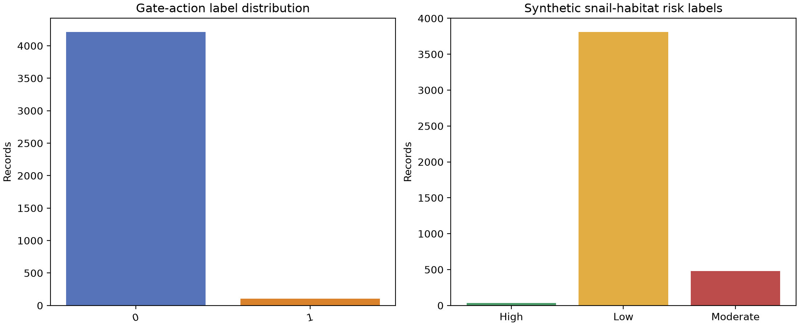
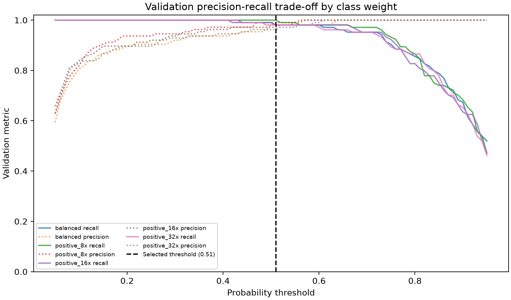
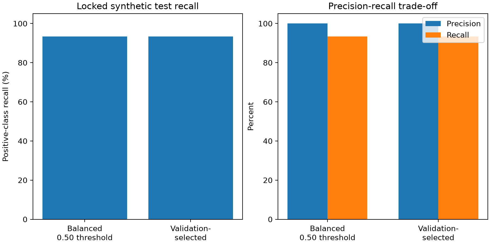
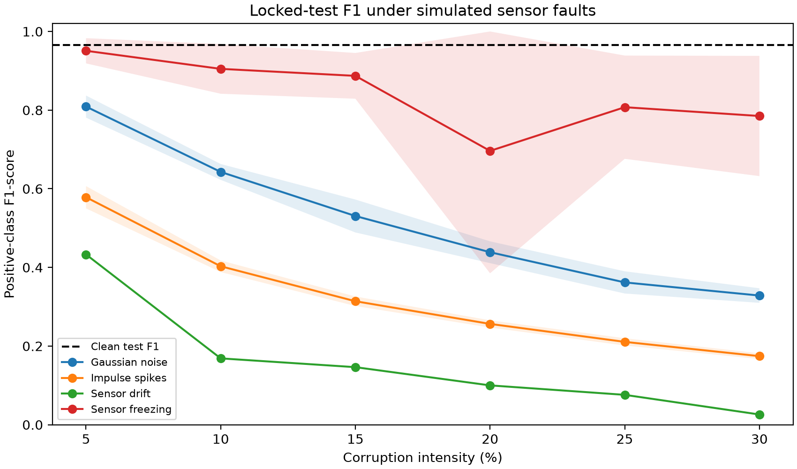
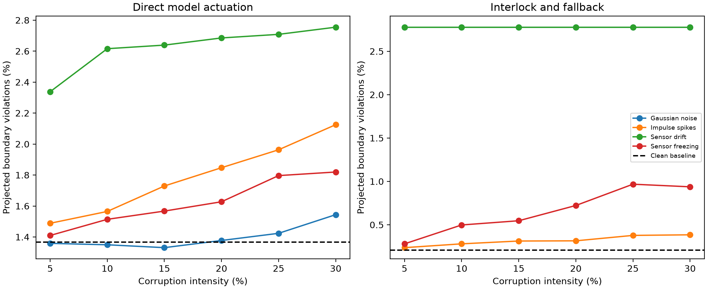

# CHAPTER 3

# RESULTS AND DISCUSSIONS

This chapter reports the results of a chronological holdout evaluation of the Random Forest classifier and controlled sensor-fault experiments using the project's synthetic rice-paddy dataset. The analysis addresses baseline classification (SOP 2), degradation under sensor corruption (SOP 3), projected AWD-boundary violations (SOP 4), software gate-control and fallback behavior relevant to the proposed embedded validation (SOP 5), and provisional quality-assurance recommendations (SOP 6).

The results are computational simulations. The dataset and target labels are synthetic, actuator response rates are assumed for the one-hour projection, and the fault-injection mask used in part of the fallback analysis is an oracle. The experiments do not establish field performance, physical irrigation safety, or schistosomiasis mitigation effectiveness.

## 3.1 Dataset Profile and Baseline Performance (SOP 1 and SOP 2)

### 3.1.1 Dataset characteristics

The active dataset contains 4,320 records, with one simulated observation for each hour in a 180-day period from January 1, 2024, at 00:00 through June 28, 2024, at 23:00. Each record has 14 columns: 12 model predictors, the `Snail_Habitat_Risk` label, and the `AWD_Gate_Action` target. Time is represented by three separate predictors—`Month`, `Day_of_Week`, and `Hour`—rather than by a full date-time column. The other predictors are `Crop_Growth_Stage`; four hydrological or water-quality measurements (`Water_Table_Depth_cm`, `Inundation_Duration_Days`, `Water_Flow_Velocity_ms`, and `Water_pH`); two soil measurements (`Soil_Moisture_VWC_Percent` and `Soil_Temperature_C`); and two vegetation measurements (`Vegetation_Coverage_Percent` and `Vegetation_Height_cm`). The CSV contains no missing values.

These records were generated by `generate_philippines_rice_paddy_awd_dataset.py` using a fixed random seed, not collected by field sensors. The generator advances an hourly calendar and assigns crop stages using a repeating 120-day schedule: transplanting, vegetative/tillering, reproductive/flowering, and ripening/maturation. It simulates water-table depth as a gradual time series affected by an 18-day drawdown cycle, crop stage, a day-night variation, a simplified seasonal rainfall factor, and random variation; during flowering, water depth is constrained to remain above zero and at or below the simulated reflood target. Soil moisture is calculated in relation to the water-table level and then varied by rainfall and random noise. Soil temperature follows a simplified daily solar cycle, while flow velocity and water pH are generated from water, rainfall, temperature, and random components. Vegetation coverage and height increase with simulated crop-cycle progress. These mechanisms create internally related, bounded values for controlled model experiments; they do not reproduce measured weather, soil, hydrology, crop development, or sensor behavior at a specific Philippine farm.

The two labels are also generated from rules rather than independently observed outcomes. `AWD_Gate_Action` is set to `1` (open/reflood) during flowering when the simulated water-table depth is below 2 cm, or outside flowering when depth is at or below -15 cm or soil moisture is at or below 25%; otherwise it is `0` (close/maintain). `Snail_Habitat_Risk` is assigned using configured combinations of inundation duration, soil temperature, water pH, and soil moisture thresholds. These labels therefore represent the generator's assumed decision and risk rules, not observed gate operations, snail presence, or disease transmission.

**Table 3.1. Selected descriptive statistics for the synthetic dataset**

| Variable | Unit | Minimum | Maximum | Mean |
|---|---:|---:|---:|---:|
| Water-table depth | cm | -16.811 | 5.374 | -4.136 |
| Inundation duration | days | 0.000 | 15.583 | 1.116 |
| Water-flow velocity | m/s | 0.000 | 0.350 | 0.148 |
| Water pH | pH | 6.028 | 7.405 | 6.750 |
| Soil moisture | % VWC | 20.684 | 80.959 | 53.732 |
| Soil temperature | °C | 19.819 | 32.997 | 25.427 |
| Vegetation coverage | % | 10.000 | 95.000 | 52.608 |
| Vegetation height | cm | 5.000 | 120.000 | 62.765 |

`AWD_Gate_Action` is the binary prediction target: `1` means the generated rule calls for opening the inlet gate to reflood, while `0` means closing it or maintaining its current state. The generator applies a stage-specific rule. During reproductive/flowering, it assigns `1` if the water-table depth is below 2 cm. At all other crop stages, it assigns `1` if either the water-table depth is at or below -15 cm or soil moisture is at or below 25%; otherwise the label is `0`. The non-flowering conditions are combined with a logical OR, so either threshold is sufficient to trigger the positive label. These thresholds encode the study's simulated decision logic; they do not represent observed gate operations or independently validated operating instructions.

`Snail_Habitat_Risk` is a separate, rule-derived categorical label and is not included among the 12 predictor variables used to train the Random Forest; the model predicts gate action, not snail risk. The generator first assigns **High** risk when inundation duration is greater than 14 days, soil temperature is from 15°C through 30°C, water pH is from 5.5 through 7.9, and soil moisture is from 20% through 80%. If the High-risk rule is not met, it assigns **Moderate** when inundation exceeds 3 days, temperature is from 15°C through 32°C, pH is from 5.3 through 8.1, and moisture is from 20% through 80%. Records meeting neither set of conditions are labeled **Low**. Because the High rule is evaluated first, a record meeting it is labeled High rather than Moderate, even though it also falls within the broader Moderate ranges. These categories describe the generator's assumed environmental criteria; they are not direct observations of snail presence, infection, or disease-transmission risk.

**Table 3.2. Generated label distribution**

| Label | Category | Records | Percentage |
|---|---|---:|---:|
| `AWD_Gate_Action` | 0 — close/maintain | 4,213 | 97.52% |
| `AWD_Gate_Action` | 1 — open/reflood | 107 | 2.48% |
| `Snail_Habitat_Risk` | Low | 3,810 | 88.19% |
| `Snail_Habitat_Risk` | Moderate | 478 | 11.06% |
| `Snail_Habitat_Risk` | High | 32 | 0.74% |

The target is highly imbalanced: only 2.48% of records require an open/reflood action. Consequently, accuracy alone can obscure weak detection of the positive action class.

### 3.1.2 Chronological baseline

The dataset was divided in chronological order rather than randomly shuffled: the first 80% of records (3,456 hourly observations) were used to fit the model, and the final 20% (864 later observations) were held out for testing. This prevents the same rows from appearing in both sets and provides a limited test of how a model trained on earlier simulated observations performs on a later part of the generated series. The held-out segment contained 844 negative (`0`) and 20 positive (`1`) gate-action labels, reflecting the target's strong class imbalance.

The fitted pipeline one-hot encoded the three categorical predictors (`Month`, `Day_of_Week`, and `Crop_Growth_Stage`) and passed the numeric measurements through to a Random Forest classifier. The classifier used 400 trees and `class_weight="balanced"`, which assigns greater training weight to the less frequent positive class to reduce the tendency to favor the majority class. A fixed random seed of 42 was used for the classifier so the experiment can be reproduced with the same data and software setup. Class weighting does not balance the held-out test set or guarantee high positive-class recall; the test metrics below show the model's measured performance on its 20 positive examples.

**Table 3.3. Chronological held-out baseline performance**

| Metric | Result |
|---|---:|
| Accuracy | 98.50% |
| Precision | 88.89% |
| Recall | 40.00% |
| F1-score | 55.17% |
| Mean absolute error | 0.0150 |

**Table 3.4. Baseline confusion matrix**

| Actual class | Predicted 0 | Predicted 1 |
|---|---:|---:|
| 0 — close/maintain | 843 | 1 |
| 1 — open/reflood | 12 | 8 |

Although overall accuracy was 98.50%, the classifier identified only 8 of the 20 positive test actions, giving 40.00% recall. The model missed 12 positive actions in the held-out period. This illustrates why positive-class recall and the confusion matrix are more informative than accuracy alone for an imbalanced gate-control task. The reported MAE is the error proportion for binary predictions and therefore does not provide an independent performance measure.

The chronological baseline is substantially lower than the earlier saved full-dataset robustness baseline. The earlier robustness evaluator scored the model on all 4,320 rows, including training rows, so that result was not an independent test estimate. The chronological holdout is the result reported here.

### 3.1.3 Validation-based model and threshold selection

The low-recall chronological result motivated a separate recall-oriented experiment. Rather than repeatedly adjusting the model against the chronological test rows, four independently seeded realizations of the same generator (seeds 42–45; 17,280 records in total) were used for fitting. Class weights (`balanced`, positive-class weight 8, 16, and 32) and probability thresholds from 0.05 to 0.95 in 0.01 increments were compared on a separate validation realization (seed 46; 4,320 records, 104 positive actions). The preselected objective was positive-class F2, which weights recall more heavily than precision; ties were resolved by higher precision and then the higher threshold.

The validation search selected a positive-class weight of 8 and a probability threshold of 0.51. On validation data, this operating point achieved 100.00% recall, 99.05% precision, and a 99.81% F2-score. At the default 0.50 threshold, the balanced model had 99.04% recall, 98.10% precision, and a 98.85% F2-score.

**Table 3.5. Locked test comparison after validation-only selection**

| Metric | Balanced model, threshold 0.50 | Selected model, threshold 0.51 |
|---|---:|---:|
| Accuracy | 99.88% | 99.88% |
| Precision | 100.00% | 100.00% |
| Recall | 93.42% | 93.42% |
| F1-score | 96.60% | 96.60% |
| F2-score | 94.67% | 94.67% |
| False positives | 0 | 0 |
| False negatives | 5 | 5 |
| True positives | 71 | 71 |
| True negatives | 4,244 | 4,244 |

The locked test used a fifth realization (seed 47; 4,320 records, 76 positive actions). Model selection and threshold choice were completed using only the training and validation seeds before test evaluation. The selected model and balanced default produced the same test predictions: tuning improved the validation operating point but did **not** improve the measured test metrics over the default baseline. This is an important negative result and is retained rather than changing the model after seeing test performance.

These seed-based results and the chronological 80/20 result answer different questions. The earlier chronological test produced 40.00% recall on one later segment of the original sequence. The seed-based test measures performance on another random realization generated under the same fixed simulator assumptions; it is not evidence of performance on a genuinely new farm, season, sensor, or labeling process. The strong seed-based result therefore demonstrates approximation of the synthetic generator, not practical or field readiness.

## 3.2 TFCST Environmental Noise Degradation (SOP 3)

The validation-selected model (positive-class weight 8, threshold 0.51) was evaluated on the locked seed-47 test realization under Gaussian noise, impulse spikes, progressive sensor drift, and sensor freezing. Each fault profile was tested at 5%, 10%, 15%, 20%, 25%, and 30% intensity. Ten seeded corruption trials were run for each condition. The following table reports positive-class precision, recall, and F1-score as mean ± standard deviation. The model, threshold, and test realization were held fixed; the standard deviation therefore measures variation in injected corruption, not variation across independently trained models or field datasets.

**Table 3.6. Locked synthetic test precision, recall, and F1 under simulated corruption**

| Fault profile | Intensity | Precision (%) | Recall (%) | F1-score (%) |
|---|---:|---:|---:|---:|
| Gaussian noise | 5% | 80.4 ± 3.8 | 81.6 ± 3.5 | 80.9 ± 2.8 |
| Gaussian noise | 10% | 57.6 ± 1.6 | 72.8 ± 3.9 | 64.3 ± 2.0 |
| Gaussian noise | 15% | 42.8 ± 4.1 | 70.1 ± 3.6 | 53.1 ± 4.2 |
| Gaussian noise | 20% | 32.3 ± 2.4 | 68.8 ± 4.2 | 43.9 ± 2.8 |
| Gaussian noise | 25% | 25.1 ± 2.1 | 65.5 ± 6.2 | 36.3 ± 2.9 |
| Gaussian noise | 30% | 22.0 ± 1.4 | 65.3 ± 3.8 | 32.9 ± 1.9 |
| Impulse spikes | 5% | 42.6 ± 2.9 | 91.2 ± 1.9 | 58.0 ± 2.9 |
| Impulse spikes | 10% | 26.2 ± 1.0 | 88.0 ± 3.2 | 40.3 ± 1.4 |
| Impulse spikes | 15% | 19.3 ± 0.8 | 85.8 ± 3.0 | 31.5 ± 1.2 |
| Impulse spikes | 20% | 15.2 ± 0.6 | 84.6 ± 1.5 | 25.8 ± 0.9 |
| Impulse spikes | 25% | 12.2 ± 0.6 | 82.8 ± 2.7 | 21.2 ± 1.0 |
| Impulse spikes | 30% | 9.8 ± 0.4 | 79.6 ± 4.4 | 17.5 ± 0.8 |
| Sensor drift | 5% | 100.0 ± 0.0 | 27.6 ± 0.0 | 43.3 ± 0.0 |
| Sensor drift | 10% | 100.0 ± 0.0 | 9.2 ± 0.0 | 16.9 ± 0.0 |
| Sensor drift | 15% | 100.0 ± 0.0 | 7.9 ± 0.0 | 14.6 ± 0.0 |
| Sensor drift | 20% | 100.0 ± 0.0 | 5.3 ± 0.0 | 10.0 ± 0.0 |
| Sensor drift | 25% | 100.0 ± 0.0 | 3.9 ± 0.0 | 7.6 ± 0.0 |
| Sensor drift | 30% | 100.0 ± 0.0 | 1.3 ± 0.0 | 2.6 ± 0.0 |
| Sensor freezing | 5% | 100.0 ± 0.0 | 90.8 ± 5.6 | 95.1 ± 3.2 |
| Sensor freezing | 10% | 97.9 ± 6.8 | 84.3 ± 7.3 | 90.5 ± 6.3 |
| Sensor freezing | 15% | 100.0 ± 0.0 | 80.1 ± 8.8 | 88.7 ± 5.8 |
| Sensor freezing | 20% | 77.6 ± 38.5 | 82.5 ± 10.0 | 71.7 ± 30.2 |
| Sensor freezing | 25% | 93.1 ± 21.7 | 74.2 ± 5.6 | 80.7 ± 13.1 |
| Sensor freezing | 30% | 88.7 ± 24.9 | 77.0 ± 9.7 | 79.3 ± 14.5 |

Full accuracy, MAE, F2-score, replicate-level results, and standard deviations are preserved in `reports/chapter3_tuning/robustness_summary.csv` and `robustness_replicates.csv`.

Gaussian noise reduced mean F1 from 96.60% on clean test inputs to 32.85% at 30%. Impulse spikes had high recall but poor precision as intensity increased, indicating many false open/reflood predictions. Drift retained 100% precision in these trials because it produced very few positive predictions, but recall fell from 27.63% at 5% drift to 1.32% at 30%; high accuracy under this imbalanced target must not be mistaken for useful positive-action detection. Freezing showed the greatest variability, especially at 20% intensity. These profiles are synthetic perturbations, and non-monotonic results reflect the specific injection procedure and random seeds rather than a smooth physical degradation law.

The freezing injector modifies contiguous blocks. At some levels, the selected block's size and position can affect the measured score; the repeated runs quantify injector randomness, not the frequency or behavior of real sensor failures.

## 3.3 Failure Threshold and AWD Boundary Analysis (SOP 4)

The adopted standard simulation limits are an AWD lower threshold of -15 cm outside flowering, a minimum water depth above 0 cm during flowering, and a +5 cm upper threshold. For one-hour projections, an open gate is assumed to raise water depth by 1.0 cm and a closed gate to lower it by 0.5 cm. These response rates are explicit modeling assumptions and have not been calibrated against a physical paddy or gate.

For each held-out test record, predicted gate action was projected for one hour from the original synthetic water state. A second projection applied a simple safety interlock that overrides an open/close prediction if its one-hour projection would cross the adopted lower or upper limit. For corrupted cases, the sensor-injection program also supplied an oracle fault flag to the fallback controller. That flag means the simulator knows which records it corrupted; it is not a demonstrated sensor-fault detector.

**Table 3.7. One-hour projected AWD boundary violations and fallback activity**

| Fault profile | Intensity | Direct violations (mean records) | Direct rate | Interlock/fallback violations (mean records) | Interlock/fallback rate | Oracle safe-mode rate |
|---|---:|---:|---:|---:|---:|---:|
| Clean baseline | 0% | 59.0 | 1.37% | 9.0 | 0.21% | 2.04% |
| Gaussian noise | 5% | 58.7 | 1.36% | 120.0 | 2.78% | 100.00% |
| Gaussian noise | 15% | 57.6 | 1.33% | 120.0 | 2.78% | 100.00% |
| Gaussian noise | 30% | 66.7 | 1.54% | 120.0 | 2.78% | 100.00% |
| Impulse spikes | 5% | 64.3 | 1.49% | 10.2 | 0.24% | 6.91% |
| Impulse spikes | 15% | 74.7 | 1.73% | 13.5 | 0.31% | 16.66% |
| Impulse spikes | 30% | 92.0 | 2.13% | 16.6 | 0.38% | 31.36% |
| Sensor drift | 5% | 101.0 | 2.34% | 120.0 | 2.78% | 100.00% |
| Sensor drift | 15% | 114.0 | 2.64% | 120.0 | 2.78% | 100.00% |
| Sensor drift | 30% | 119.0 | 2.75% | 120.0 | 2.78% | 100.00% |
| Sensor freezing | 5% | 60.9 | 1.41% | 12.1 | 0.28% | 6.84% |
| Sensor freezing | 15% | 67.7 | 1.57% | 23.6 | 0.55% | 16.90% |
| Sensor freezing | 30% | 78.4 | 1.81% | 40.5 | 0.94% | 31.43% |

With the tuned model on clean seed-47 inputs, the one-hour interlock reduced projected boundary violations from 59 to 9 of 4,320 records (1.37% to 0.21%). The result depends on the assumed actuator rates and simulated physical states; it is not field verification. At 5% drift, classifier recall was already 27.63%, falling to 9.21% at 10% and 1.32% at 30%. No tested drift intensity eliminated all positive predictions, so the earlier chronological classifier's 10% zero-recall result must not be presented as a universal failure threshold for this tuned model.

The fault mask is an oracle: every Gaussian-noise and drift input row is marked faulted, so the controller enters safe mode on all 4,320 records in those cases. Holding the initial closed command then produced 120 projected boundary violations (2.78%), corresponding to the simulated flowering rows. This illustrates that hold-last-command avoids a new automatic model decision but does not guarantee safe physical conditions. Manual review or a separately validated physical fallback is needed before operational use.

## 3.4 Gate-Control Logic and Embedded Simulation Status (SOP 5)

A software controller was implemented and tested for freshness, invalid or out-of-range readings, externally flagged sensor faults, and three consecutive identical numeric readings. In these conditions it enters safe mode, holds the previous gate command, and returns a reason code for review. For valid readings, a one-step interlock overrides commands whose projected water depth would cross the configured limits.

Twelve automated unit tests passed. In addition to controller and corruption checks, they cover reproducibility and class support across generated seeds, threshold selection by validation F2, use of an explicit threshold in the one-sample prediction helper, and acceptance of candidate class weights. These tests establish Python code behavior only.

The thesis proposes ESP32 execution in Wokwi, but no Wokwi project, ESP32 firmware, simulator run, embedded inference measurement, actuation latency, or hardware-in-the-loop trace was available or executed for these results. Therefore, SOP 5 is only partially addressed: the control and fallback logic has been exercised in software, but embedded/Wokwi validation remains outstanding. Python execution time must not be reported as ESP32 latency.

## 3.5 Quality-Assurance and Provisional Maintenance Protocols (SOP 6)

The experiments support conditional recommendations for future testing, rather than validated field maintenance schedules:

1. **Enter safe mode for stale or invalid inputs.** The implemented software controller treats readings older than 3,600 seconds, missing or non-finite numeric values, out-of-range values, or invalid category values as unusable. It holds the last gate command and flags the reason. The one-hour staleness limit is a simulation setting and must be matched to the intended sensor sampling frequency.
2. **Check for frozen data.** The prototype detects when an individual sensor signal repeats for three consecutive readings and enters safe mode. This simple rule needs field validation to determine false-alarm and missed-detection rates.
3. **Treat detected drift as a maintenance condition.** On the tuned model's locked synthetic test, recall fell from 93.42% on clean input to 27.63% at 5% drift and 9.21% at 10% drift. These measured intensities identify degradation in this injector, not an allowable field operating range; a real maintenance trigger requires calibrated sensor error limits and field measurements.
4. **Prioritize recall and F1-score while monitoring false alarms.** Validation-selected tuning achieved 100% recall on seed 46, but the locked test result was 93.42% and exactly matched the balanced default model. The earlier chronological test had only 40.00% recall. An operational acceptance threshold must be set with adviser/engineering input and validated using representative independent observations; neither 0.51 nor these synthetic results establish a deployment-ready threshold.
5. **Validate the complete fallback path.** The oracle fault flag used in the experiment is not a deployable detector. Real fault detection for drift, noise, and freezing must be separately evaluated, and the hold-last-command policy must be compared against an independently approved physical fallback using simulator or field evidence.
6. **Repeat with independent periods and data.** The seeded train/validation/test realizations share the same generator and calendar assumptions. Repeated corruption runs quantify random injector variation only. Evaluation on new periods, sensors, farms, and independently collected gate-action observations is still required.

No cleaning interval, recalibration calendar, or guaranteed Schistosomiasis risk reduction can be inferred from the current synthetic experiment. The recommendations are design and validation targets, not validated operational protocols.

## 3.6 Chapter Summary

The initial chronological 80/20 experiment achieved 98.50% accuracy but only 40.00% recall and 55.17% F1 on its 864-row test segment, demonstrating the risk of judging an imbalanced target by accuracy. A separate, validation-tuned experiment trained on seeds 42–45, selected an 8× positive-class weight and 0.51 threshold using seed 46, then achieved 99.88% accuracy, 93.42% recall, and 100% precision on untouched seed 47. The tuned model's locked-test metrics exactly matched the balanced 0.50 baseline; the validation improvement did not translate into a measurable test improvement. Both seed-based results remain limited to the same synthetic generator.

On the tuned test, ten corruption trials per condition showed substantial recall/F1 deterioration, especially under drift and impulse spikes. The one-hour synthetic boundary projection reduced violations from 59 to 9 on clean input, but the hold-last-command fallback did not guarantee boundary compliance under faulted inputs. Twelve automated tests passed. Actual ESP32/Wokwi validation, field-calibrated actuator response, real sensor-fault detection, and field-data evaluation remain necessary before Chapter 3 can claim embedded validation, operational safety, or validated maintenance scheduling.

## Reproducibility and Methodology Alignment

The initial chronological experiment can be rerun using `python src/chapter3_experiments.py --repeats 10`; its outputs are under `reports/chapter3_experiments/`. The tuned experiment can be rerun using `python -m src.tune_gate_model --repeats 10`; it writes its model, metrics, tables, and figures under `reports/chapter3_tuning/`. Before final thesis submission, align Chapter 2 with both procedures and clearly distinguish the chronological test from the independent-seed synthetic test. Both use synthetic rather than empirical data, 5–30% corruption levels in 5-point increments, ten repeated corruption trials, and one-hour actuator assumptions. Wokwi/ESP32 execution was not completed.
